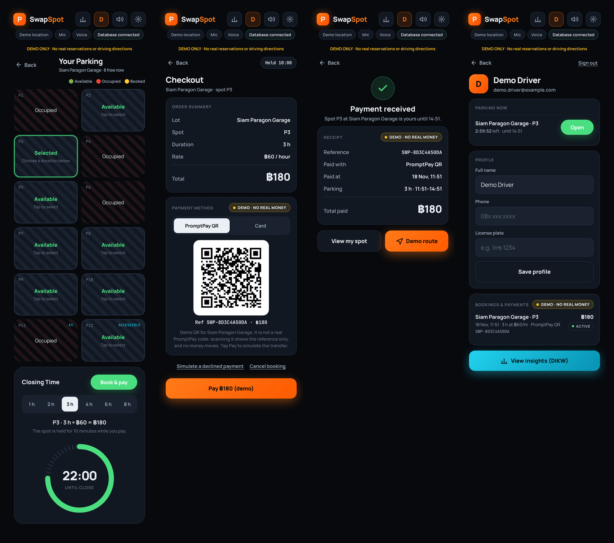
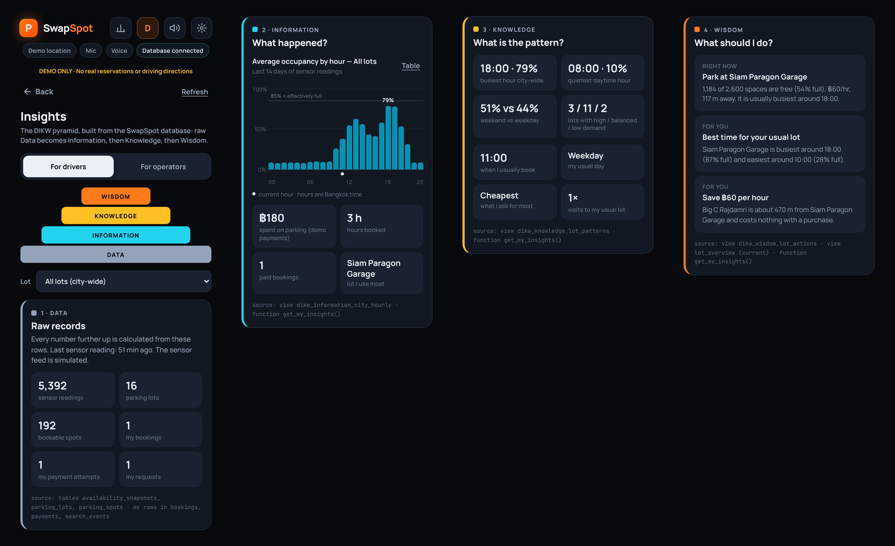
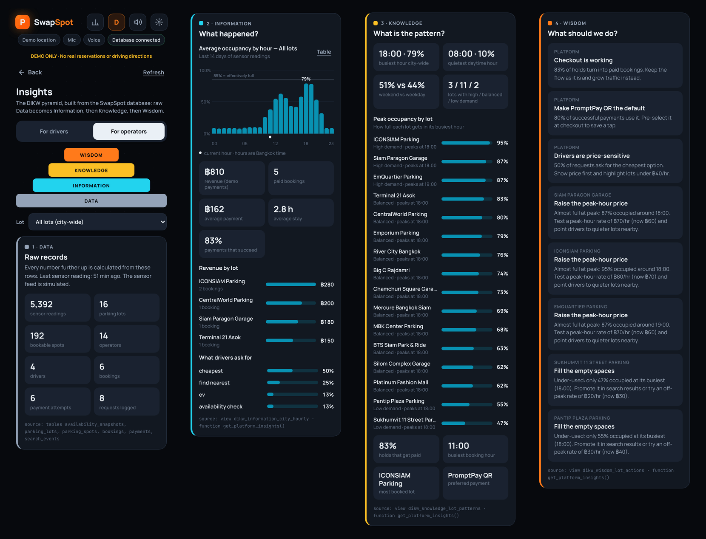

# DBT315 Final Project Report

## SwapSpot: Voice-First Parking Finder

**Written Group Platform Dossier — Draft from the current project**

| Report information | Detail |
|---|---|
| Course | DBT315 Platform Design, Thammasat University |
| Project | SwapSpot |
| Group |  |
| Team members and student IDs |  |
| Submission date |  |

> **About this draft:** This report uses plain language and describes only what can be seen in the current project files. The app is a demonstration. Parking places, accounts, bookings, and payments are now saved in a project database, but the numbers of open spaces come from a simulated sensor feed, a booking does not reserve a real parking space, the checkout takes no money, and the route preview is not driving directions. Details that are not in the project have been left blank instead of guessed.

## Executive Summary

SwapSpot is a parking-finder demonstration for people looking for parking. It shows 16 sample parking places in central Bangkok. A visitor can ask for parking by speaking or typing, compare prices and features, look at a map, and open screens for parking spots, a route, or a camera. A visitor who creates an account can also hold a spot, go through a demo checkout, follow a countdown for the booked time, and look back at earlier bookings. An Insights screen turns the saved readings into simple advice for drivers and for parking operators.

The current version is a demonstration, not a live parking marketplace. The parking places, their spots, each account, each booking, and each payment attempt are saved in a database. The database also sets the price, holds a chosen spot for 10 minutes, and makes sure the same spot cannot be booked twice. However, the numbers of open spaces come from a simulated sensor feed, a booking is not sent to any parking operator, and the checkout is a simulation in which no money moves. The route and camera views are also simulated. The project does not show a live connection with parking operators, a supplier sign-up process, real customer research, real payments, or a record of real sales.

The project files show what the visitor can do, but do not provide evidence about whether drivers want the service, whether parking operators would join, how much either side would pay, or whether the business could earn more than it costs. Those details are left blank in this draft.

# Chapter 1: The Problem, First Customers, and Project Changes

## 1.1 The Problem and First Market

The project presents a service for finding parking places. It lets a visitor search by area, price, distance, and features such as covered parking, EV charging, or accessible spaces. Its sample parking places are located around central Bangkok.

The project files do not include interviews, surveys, market research, or test results proving that this is a problem people will pay to solve. The exact first customer group and the size of the market are therefore:

| Question | Detail |
|---|---|
| First group of customers to serve |  |
| Main parking problem confirmed by research |  |
| Evidence that this problem is common or costly |  |
| First location or neighborhood to launch in |  |
| Main alternatives people use today |  |

## 1.2 Who Takes Part and What They Exchange

The app suggests two possible sides: people looking for parking and parking-place operators. The project has not connected the sample operators to the app, so the diagram below describes the current demonstration, not an active business relationship.

```text
People looking for parking
  - Give: a typed or spoken request and parking preferences;
          with an account: an email address, a name, a chosen spot, and a duration
  - Receive: parking listings, simulated availability, a held spot with a timer,
             a demo receipt, a booking history, and simple advice
                     |
                     v
             SwapSpot demonstration
  - Shows listings, map, prices, and features from its database
  - Saves accounts, bookings, and demo payments; sets the price;
    prevents the same spot from being booked twice
  - Does not collect a real payment, and no operator confirms a booking
                     |
                     v
Parking-place operators named in sample data
  - Live information supplied to SwapSpot:
  - Confirmed business relationship:
```

| Exchange between the sides | Detail |
|---|---|
| What visitors give or contribute | A request and optional parking preferences during the demo. With an account: an email address, a name, and, if the visitor wishes, a phone number and a licence plate. For a signed-in visitor the kind of request (for example "cheapest" or "EV charging") is saved; the words themselves are not. |
| What visitors receive today | Parking listings with simulated availability; a spot held for 10 minutes; a demo checkout and receipt; a countdown for the booked time; a booking history; and advice on the Insights screen. |
| What operators give to the live service |  |
| What operators receive from the live service | Nothing yet. The Insights screen shows what an operator could receive: how full each parking place gets by hour, and a suggestion to raise or lower its price. Today this is calculated from simulated readings. |
| Money paid by visitors or operators | None. The checkout is a simulation: it records a payment attempt and a reference number, but no money moves. |
| Trust or safety checks between the sides | For visitors: sign-in with an email address and a password; each visitor can see only their own profile, bookings, and payments; the database sets the price and refuses a second booking of the same spot. For operators: none; no operator is identified or checked. |

## 1.3 Changes from Midterm to Final

The project files do not include the midterm feedback itself, a change log, or a record of decisions made after a presentation. The rows below record the mentor feedback received before the final version and the changes made in response. Midterm items that the team remembers should be added.

| Midterm idea or feedback | Change made for the final version | Reason / evidence |
|---|---|---|
| Mentor feedback: connect the data to Supabase and show DIKW | The parking places, spots, bookings, and payments were moved into a Supabase database. An Insights screen shows how raw data becomes information, knowledge, and advice. | `supabase/migrations/`, `docs/database.md`, Insights screen in the app |
| Mentor feedback: add a sign-in feature | Visitors can create an account, sign in, edit a profile, and see their booking history. | Sign-in and account screens; table `profiles` |
| Mentor feedback: add payment features | A demo checkout (PromptPay QR or test card) with a receipt. Every attempt is recorded. No money moves. | Checkout screen; table `payments` |
|  |  |  |

# Chapter 2: Service Experience and Business Model

## 2.1 Service Walkthrough

This table follows a visitor through the current demonstration. A "behind-the-scenes" step means work performed inside the app or its database; it does not mean a real parking operator has received the request.

| Step | Visitor action | What the app shows | What happens behind the screen | Real operator involvement |
|---|---|---|---|---|
| 1. Ask for parking | Speaks, types, or chooses a suggested request | A short answer and a list or map of sample places | The app looks for words such as a place name, price, distance, or feature. For a signed-in visitor it saves the kind of request, not the words. |  |
| 2. Compare places | Searches, changes filters, or opens a place | Price, open-space count, distance, hours, and features | The app reads the list of places from the database every 20 seconds, then checks and sorts it |  |
| 3. View a place | Opens its detail page | Address, price, spaces, rating, and features | The app displays the information stored for that place |  |
| 4. Sign in | Creates an account or signs in with an email address and a password | The account screen, or the screen the visitor came from | The sign-in service checks the password. The database creates a profile for a new account. |  |
| 5. Choose a spot | Taps an open spot and picks a duration | The price and a "Book & pay" button | The database checks that the spot is still free, holds it for 10 minutes, and calculates the price |  |
| 6. Pay (demo) | Picks PromptPay QR or card and taps Pay | A receipt with a reference number | The database records the payment attempt as paid and starts the booked time. No money moves. |  |
| 7. Park and finish | Watches the timer; taps End to finish early | A countdown, a reminder 15 minutes before the end, then the booking in the history | The database marks the booking as finished and frees the spot. It also does this by itself when the time is up. |  |
| 8. View a route or camera | Opens the route or camera page | A map preview or a static image with moving labels | The app draws a sample route or changes sample camera labels |  |
| 9. See insights | Opens the Insights screen | Raw records, what happened, the pattern, and advice | The database calculates averages, patterns, and advice from the saved readings, bookings, payments, and requests |  |



*Figure 1. Steps 5 to 7 in the app: choosing a spot and a duration, the demo checkout, the receipt, and the account screen with the booking in its history. The account and the booking are test data, and no money moved.*

## 2.2 Four-Part Return Loop

The service can be described with a simple four-part loop. This describes the screens and behavior in the demo; it does not prove that visitors form a habit or return to use it.

| Part of the loop | What is present in the demo |
|---|---|
| Reminder to use it | A visitor may open SwapSpot when looking for parking. During a booking the app gives a reminder 15 minutes before the time ends. A saved reminder outside the app or an advertising campaign is not shown. |
| Easy first step | Tap the microphone, type a request, or choose a suggested request. |
| Changing result | Different sample places, prices, features, and simulated availability can appear for different requests. |
| Saved benefit for next time | Parking preferences are saved in the browser. With an account, past bookings and payments are kept and shown on the account screen, and the Insights screen gives tips based on the visitor's own bookings. Loyalty rewards are not shown. |

The database can now count how often an account comes back (bookings and requests per account). So far it holds only test accounts.

Evidence that visitors return, and how often they return |  

## 2.3 Pricing and Business Model

The app displays sample hourly and daily prices for parking places. These are listing details in the demonstration, not a price charged by SwapSpot. In the demo checkout the visitor is charged the place's own price: the hourly rate multiplied by the hours, and never more than the place's daily maximum. The database calculates this amount. The project files do not include a service fee, commission, payment split, deposit, or operating-cost estimate.

| Business question | Detail |
|---|---|
| Price charged by SwapSpot to visitors | In the demo: nothing on top of the parking place's own price. A real fee has not been set. |
| Fee or commission charged to operators |  |
| Portion of each payment kept by SwapSpot |  |
| Portion paid to the parking operator |  |
| Deposit, cancellation, refund, or dispute rules | In the demo: no deposit. An unpaid booking can be cancelled, and it is released by itself after 10 minutes. A paid booking can be ended early, but unused time is not refunded. There is no refund or dispute process. |
| Which side, if any, receives a discount or subsidy |  |
| Cost to attract one visitor |  |
| Cost to attract one parking operator |  |
| Estimated cost to run the service |  |

# Chapter 3: Working Prototype and Visitor Journeys

## 3.1 Visitor Journey: Finding a Place

1. The visitor opens the main screen and sees one nearby sample place.
2. They tap the microphone, type a request, or choose a suggested request such as "Find parking" or "EV charging."
3. SwapSpot looks through the parking places in its database and checks the requested price, distance, and features.
4. The visitor sees a list or map and can open a place for more information.
5. The visitor can ask to see a simulated route. It is not safe to use as driving directions.

## 3.2 Visitor Journey: Choosing a Spot

1. The visitor opens a place and chooses "Choose spot."
2. The app shows 12 spots as available, occupied, or booked. They come from the database.
3. The visitor taps an available spot and picks a duration from 1 to 8 hours. The app shows the price.
4. To book, the visitor signs in or creates an account with an email address and a password.
5. The database holds the spot for 10 minutes and the checkout opens. The visitor picks PromptPay QR or card and taps Pay. This is a simulation: no money is taken.
6. A receipt appears and a timer counts down the booked time. The app gives a reminder 15 minutes before the end.
7. The visitor can end the session early. The booking then appears in the history on the account screen.

No real reservation is sent to a parking operator. Unlike the earlier version, the booking is saved: it is still there after the page is reloaded.

If the database cannot be reached, the app switches to a built-in simulation and says so on the screen. In that mode a sample spot and a timer can still be tried, but nothing is saved.

## 3.3 Supplier and Platform Journeys

The project contains no screen for an operator to join, add a parking place, change its availability, manage bookings, or receive payment. The sample places are loaded into the database by the project's builders. The only part made for operators is the "For operators" tab of the Insights screen, which can be read but not changed. The work required for real operators and platform staff is:

| Journey | Current screen or process |
|---|---|
| Operator signs up or proves ownership of a lot |  |
| Operator adds or changes parking information | No operator screen. Places and prices are rows in the database that only the project team can change. |
| Operator accepts or rejects a real booking | No operator step. The database accepts a booking by itself when the spot is free. |
| Platform handles payment, refunds, or disputes | Demo payments are recorded with a reference number. Refunds and disputes are not handled. |
| Platform checks listing accuracy or customer complaints |  |

## 3.4 What Works Now, What Is Simulated, and What Is Not Built

| Part of the experience | Status in the current project |
|---|---|
| Main parking search screen | Present in the demo |
| Typed parking requests | Present in the demo |
| Speech input and spoken replies | Uses browser voice features where the browser supports them |
| Search by place, price, distance, and parking features | Runs against the sample places stored in the database |
| Map | Uses a map and public map images; the parking information is still sample data |
| Lot availability | Read from the database every 20 seconds; the numbers come from a simulated sensor feed |
| Parking spot selection | Saved as a booking in the database, with a 10-minute hold and protection against double booking; it does not reserve a real space |
| Parking timer and fee | The timer counts down the booked time. The fee is calculated by the database and "paid" only in a simulated checkout. |
| Customer account | Present: sign-up and sign-in with an email address and a password, a profile, and a booking history |
| Payment | Simulated checkout (PromptPay QR or a test card). Every attempt is recorded. No money moves. |
| Insights for drivers and operators | Present: built from saved sensor readings, bookings, payments, and requests |
| Route preview | Simulated; not driving directions |
| Camera view | Static image with simulated labels; not a live camera |
| Parking operator connection |  |
| Real-time lot availability | Not connected to real sensors or to an operator's system |
| AI service | Not connected; the assistant follows written rules |

## 3.5 Build Tools in Plain Language

The project is a website made with Next.js, React, and TypeScript. It uses Leaflet to show the map, OpenStreetMap for map images, and the browser's built-in speech features when available. Its information is kept in a Supabase database (PostgreSQL), which also handles sign-in. The project files include software checks for search, settings, parking calculations, session timing, voice-command rules, booking and price rules, and the reading of database records.

| Project access item | Link |
|---|---|
| Public demo link | <https://swapspot-demo.netlify.app> (a test version on Netlify, connected to the project database; demonstration only) |
| Backup demo video |  |
| Design board / Miro link |  |
| Database design (diagram of the tables and a list of every column) | `docs/database.md` in the project |
| Database setup files | `supabase/migrations/` in the project |

## 3.6 The Database Behind the Prototype

The prototype keeps its information in one shared database instead of inside the app. This is what makes accounts, bookings that survive a reload, and the Insights screen possible.

**What is saved**

| What is saved | Table | Example |
|---|---|---|
| Companies that run parking places | `operators` | Siam Piwat |
| Parking places | `parking_lots` | Name, address, price per hour, daily maximum, opening hours, free spaces |
| Spots that can be booked | `parking_spots` | P1 to P12 in each place: available, occupied, or reserved |
| Visitors with an account | `profiles` | Name, and optionally a phone number and a licence plate |
| Bookings | `bookings` | Which spot, how many hours, the price, and the status |
| Payment attempts | `payments` | Method, amount, reference number, and status |
| Sensor readings | `availability_snapshots` | Free spaces in each place, every 10 minutes |
| Kinds of request | `search_events` | "cheapest" or "EV charging", never the words that were spoken |

**How the tables are connected**

```text
operators ──< parking_lots ──< parking_spots ──< bookings ──< payments
                   │                                 ^
                   └──< availability_snapshots       │
                                                     │
account (sign-in) ── profiles ───────────────────────┘
                        │
                        └──< search_events >── parking_lots

A ──< B means: one A has many B.
```

**Rules the database keeps, even if the app has a mistake**

- A spot can have only one booking in progress, and a visitor can have only one booking in progress.
- The price is calculated by the database from the place's own price. The visitor's browser cannot change it.
- A spot that is not paid for is released after 10 minutes.
- A booking can be paid only once.
- A visitor can see only their own profile, bookings, and payments. Everyone can see the parking places.

**From data to advice (DIKW)**

| Level | Question | Example |
|---|---|---|
| Data | What was recorded? | A place had 140 free spaces at 18:00 on one day |
| Information | What happened? | Over 14 days the place was 93% full on average between 18:00 and 19:00 |
| Knowledge | What is the pattern? | The place is busiest at 18:00, busier at weekends, and its demand is "high" |
| Wisdom | What should we do? | Driver: book before setting off. Operator: test a higher price at the busiest hour. |

Each level is calculated inside the database from the level below it, and the Insights screen displays the result.



*Figure 2. The Insights screen for drivers. In the app the four levels follow each other down the page; here they are placed side by side. The numbers come from the sample data and one test booking.*



*Figure 3. The Insights screen for operators. The numbers come from the sample data and six test bookings made with four demo accounts.*

**What is simulated.** The sensor readings are produced by a formula with a lunch peak and an evening peak, not by real sensors. Payments are recorded but no payment company is called. The 16 places, 192 spots, and 14 days of readings are sample data loaded by a setup file.

The full design, including the diagram of all tables and a list of every column, is in `docs/database.md`.

# Chapter 4: User Testing and Improvements

The project includes checks that test whether parts of the software behave as expected, including the booking, price, and payment rules. These checks are not interviews or tests with real drivers or parking operators. No participant list, interview notes, user quotes, or before-and-after screen records are included in the inspected project.

## 4.1 People Who Tested the Service

| Tester role | How they fit the intended audience | Test setting | Task given |
|---|---|---|---|
|  |  |  |  |
|  |  |  |  |
|  |  |  |  |

Number of people who tested the app |  
Dates and location of tests |  

## 4.2 What Was Confirmed and What Caused Trouble

The project files cannot show that a feature was understood or valued by real people. Add direct evidence from user sessions before marking any assumption as confirmed.

| Assumption or screen | Confirmed / not confirmed | What the tester said or did |
|---|---|---|
| Visitors understand that spaces are real or simulated |  |  |
| Visitors trust the availability information |  |  |
| Visitors understand the listed price |  |  |
| Visitors can find and compare places |  |  |
| Visitors can create an account and sign in |  |  |
| Visitors understand that a booking in the app does not reserve a real space |  |  |
| Visitors understand that the checkout takes no real money |  |  |
| Visitors understand that the route is not for driving |  |  |
| Visitors find the advice on the Insights screen useful |  |  |
| Operators want to join or update their listings |  |  |

## 4.3 Visitor Friction and Drop-Off

| Where the visitor hesitated or stopped | Direct quote / observation | How often it happened |
|---|---|---|
|  |  |  |
|  |  |  |
|  |  |  |

Once real visitors use the app, the database can show where bookings stop: it records how many held spots were paid for, cancelled, or left until the 10 minutes ran out. So far it holds only test bookings.

## 4.4 Changes Made After User Feedback

No user-feedback change record is included in the project. The table below is ready for evidence-backed updates.

| Before: screen or wording | After: screen or wording | User feedback that led to the change |
|---|---|---|
|  |  |  |
|  |  |  |
|  |  |  |

# Chapter 5: Future Growth and Trust

This chapter separates what the project now has from features that are not yet built. Sign-in and a database are now set up. Real parking connections, a real payment company, and route providers have not been chosen.

## 5.1 Physical Parking and Digital Service

The current project does not connect to parking gates, QR codes, vehicle sensors, or live cameras.

| Future service idea | Detail |
|---|---|
| How a driver would prove they arrived | Not built. The database already keeps what such a check could use: the booking, the spot label, the payment reference, and an optional licence plate in the visitor's profile. |
| QR, RFID, or other gate equipment |  |
| Live parking count source | Today a simulated feed writes a count for each place into the database every 10 minutes. A real source, such as sensors or the operator's own system, would write into the same table. None has been chosen. |
| Live camera or other equipment |  |
| Cost and party responsible for equipment |  |

## 5.2 Smart Help and Human Review

The current assistant follows written rules to understand a request. It does not connect to an AI service. Bookings and demo payments follow fixed rules in the database. A complaint or safety decision is not handled by the app.

| Future automatic task | Human who must review it |
|---|---|
| Price advice for a parking place. The Insights screen already suggests a higher price when a place is almost full at its busiest hour, and a lower one when it stays empty. | The operator of that place. The app only suggests; it never changes a price. |
| Releasing an unpaid spot after 10 minutes and ending a booking when its time is up. This is already automatic. |  |
|  |  |

## 5.3 Fair Rules, Privacy, and Staying on the Platform

The project now includes accounts and user profiles. It does not include real payment details: the demo checkout never asks for a card number. It has no operator messaging. It saves parking preferences in the visitor's browser. The microphone and browser speech features are subject to the visitor's browser permissions; the project notes that some browsers may use a remote speech service.

| Trust or privacy question | Detail |
|---|---|
| What user information will be collected and why | Collected in the demo today: an email address and a password for sign-in (the password is handled by the sign-in service and never stored by the app); a name; an optional phone number and licence plate; bookings; payment attempts (method, amount, reference number); and the kind of request a signed-in visitor makes, to learn what drivers ask for. |
| Which optional information will not be collected | In the demo: the words a visitor speaks or types are not saved, only the kind of request. The app saves no voice recording. No card number is asked for. The visitor's real location is not read; the location is simulated. |
| How a visitor can remove their information | Not built in the app yet. The database is set up so that deleting an account also deletes its profile, bookings, payments, and requests. Today only the project team can do this. |
| How parking places will be checked for accuracy |  |
| How fake listings or unfair pricing will be handled | In the demo only the project team can add or change a parking place, and a booking keeps the price that was shown when it was made, even if the price changes later. A process for real operators has not been designed. |
| How the service will handle a complaint or refund | Not built. Each payment attempt has a reference number that a future process could use. |
| How the service will discourage parties from bypassing the platform |  |

## 5.4 First-User Growth Plan

The project does not include a launch plan, marketing results, sign-up totals, or a plan for attracting both visitors and parking operators.

| Growth question | Detail |
|---|---|
| First group of visitors to invite |  |
| First parking operators to invite |  |
| Reason each side would join before the other side is large |  |
| First target number of visitors and timeframe |  |
| Community or environmental benefit and how it will be measured |  |

# Chapter 6: Honest Review and Semester Reflection

## 6.1 Expectation Compared with What Exists

The project files do not include the midterm goals or real user-test results. The table below compares only visible project features with the evidence still needed.

| Topic | What the current project shows | What remains to be proven |
|---|---|---|
| Finding parking | Search, map, and filters work with sample places stored in the database | Whether real visitors can find a suitable real space |
| Availability | Counts are read from the database, where a simulated sensor feed changes them; 14 days of readings are kept | Whether operator data can be accurate and timely |
| Reservations | A spot can be held, paid for in a demo checkout, timed, and ended; the database prevents double booking | Whether a real operator will confirm and honor a booking |
| Accounts | Sign-up, sign-in, a profile, and a booking history work | Whether real visitors are willing to create an account |
| Payment | A simulated checkout records every attempt; no money moves | Whether a real payment company can be connected, and who pays whom |
| Insights | Patterns and simple advice are calculated from the saved data | Whether the advice is useful once the data is real |
| Route and camera | Sample route and camera screens are present | Whether live, safe, and reliable services can be provided |
| Business model | Parking prices are displayed and used in the demo checkout; SwapSpot adds no fee | Whether visitors or operators will pay SwapSpot |
| User experience | A visitor can speak or type a request | Whether real users understand and trust the service |

Midterm expectation or goal |  
What changed after the midterm |  
Evidence of user reaction |  

## 6.2 Viability: Main Advantage and Main Risk

The project files do not contain market research, competitor research, operator agreements, or real transaction data. Therefore, a proven business advantage and a confirmed market risk cannot be named from the code alone.

| Viability question | Detail |
|---|---|
| Strongest proven reason SwapSpot would win |  |
| Biggest risk to the project |  |
| Evidence supporting the reason and risk |  |
| Decision: continue, change direction, or stop |  |

## 6.3 Team Reflection and Contributions

| Team member | Student ID | Main area of work | Contribution evidence |
|---|---|---|---|
|  |  |  |  |
|  |  |  |  |
|  |  |  |  |

What the team learned about moving from a product idea to a service with more than one side |  

What the team would do differently next |  

# Appendices

## Appendix A: Current Sample Parking Information

The demonstration includes 16 sample parking places in central Bangkok, run by 14 sample operators. The project gives each sample place a name, map position, capacity, open-space count, hourly and daily prices, opening hours, features, and an operator. A setup file loads them into the database together with 12 spots that can be booked in each place (192 in total) and 14 days of simulated hourly sensor readings (5,392 readings). The same 16 places are also kept inside the app, for the built-in simulation used when the database cannot be reached. These are demonstration details, not verified live offers.

Example from the app:

| Sample place | Sample price | Sample total spaces | Sample open spaces | Notes |
|---|---:|---:|---:|---|
| Siam Paragon Garage | ฿60 per hour, ฿300 daily maximum | 2,600 | Changes with the simulated feed (520 in the built-in simulation) | Sample EV and accessible spaces; covered |

## Appendix B: Evidence Sources in the Project

- `README.md` — describes the demo, its limits, and how it can be run.
- `docs/database.md` — the database design: diagram of the tables, list of columns, rules, security, and DIKW.
- `supabase/migrations/` — the files that build the database: tables, rules, security, DIKW calculations, sample data, and scheduled jobs.
- `lib/backend.ts` — the one place where the app talks to the database.
- `lib/booking.ts` and `lib/insights.ts` — booking, price, and insight rules used by the screens.
- `lib/demo-lots.ts` — the sample parking places used by the built-in simulation.
- `components/drive-view.tsx` — main visitor screen and typed request entry.
- `components/map-view.tsx` and `components/parking-map.tsx` — map, search, filters, and lot selection.
- `components/detail-view.tsx` — parking place details.
- `components/spots-view.tsx` — spots, duration, price, and timer.
- `components/auth-view.tsx` and `components/account-view.tsx` — sign-in, profile, and booking history.
- `components/checkout-view.tsx` — demo checkout and receipt.
- `components/insights-view.tsx` — the Insights screen (DIKW).
- `components/navigation-view.tsx` — simulated route view.
- `components/camera-view.tsx` — static image and simulated camera labels.
- `components/use-speech.ts` — browser speech input and spoken replies.
- `tests/` — software checks; these are not user interviews or customer tests.
- `docs/screenshots/` — the pictures used in this report, taken from the app with sample data and test bookings.

## Appendix C: Research Materials and Links

| Item | Link / location |
|---|---|
| Prototype link | <https://swapspot-demo.netlify.app> |
| Backup screen-recording video |  |
| Design board / Miro canvas |  |
| Interview notes / test recordings |  |
| Survey results |  |

## Completion Note

This draft is based on the working demonstration and is not yet a complete 12–20 page platform dossier. A database, sign-in, and a demo checkout now exist. The major missing items are real customer and operator research, user-test evidence, a verified business model, service agreements, real payment rules, growth plans, team contribution details, and proof that a live parking service can be delivered. These sections remain blank until the team can add reliable evidence.

Before presenting the app, check that its top bar says "Database connected". If it says "Offline demo data", the app could not reach the database or the sample data has not been loaded yet (the README explains how), and nothing done in the app is being saved.
