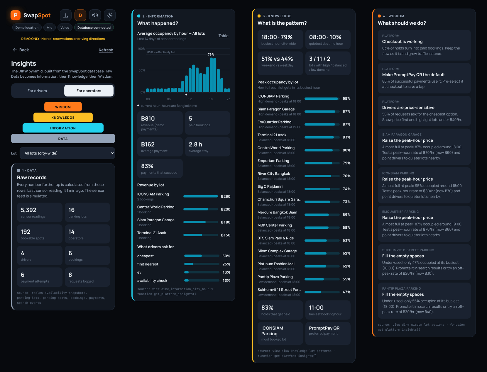
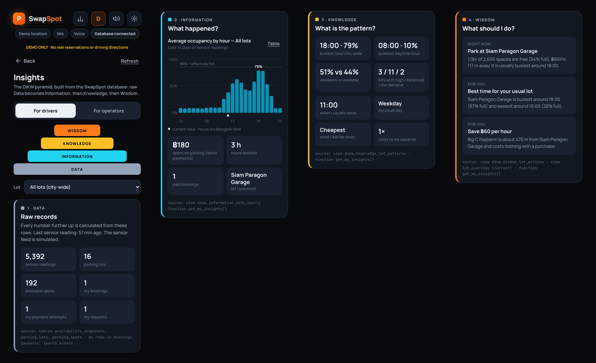

# DBT335 Final Project Report

## SwapSpot: Voice-First Parking Finder Demonstration

**Written Information Systems Blueprint — Draft based on the current codebase**

| Report field | Detail |
|---|---|
| Institution / course | Thammasat University, Faculty of Architecture and Planning — DBT335 Digital and Information Technology |
| Project | SwapSpot |
| Group |  |
| Team members |  |
| Submission date |  |
| Report status | Codebase-grounded draft; blank fields require project-team input |

> **Scope and evidence note.** This draft describes what is implemented in the repository as inspected. SwapSpot is explicitly a demonstration: parking availability (a simulated sensor feed), location, payments, camera detection, and route previews are simulated. A cloud database (Supabase: PostgreSQL, authentication, and scheduled jobs) is connected and stores lots, spots, accounts, bookings, payment attempts, sensor readings, and request categories. No live parking, operator, payment-provider, navigation, AI, or IoT service is connected. Organizational facts and operational measurements not present in the codebase are left blank rather than inferred.

## Executive Summary

SwapSpot is a browser-based, voice-first parking finder demonstration built with Next.js, React, and TypeScript on a Supabase (PostgreSQL) database. It presents 16 sample parking lots in central Bangkok, with prices, opening hours, features, and availability. Users can search by typed or spoken requests, filter and sort suitable lots, view their positions on a Leaflet map using OpenStreetMap tiles, and see a simulated route preview. Signed-in users can hold one of 192 bookable spots, complete a simulated checkout, and follow a parking session. An Insights screen presents the DIKW chain (data, information, knowledge, wisdom) computed by database views. Browser speech APIs provide voice input and output where supported. Parking preferences are stored in browser local storage.

The current implementation is a prototype information system, not one connected to parking operators. Lot, spot, account, booking, payment, sensor-reading, and request data are stored in a relational database with primary and foreign keys, constraints, row level security, and database functions that own the booking and payment rules. Availability is produced by a simulated sensor feed that a scheduled database job advances every minute; payments are simulated and recorded with `provider = 'demo'`; and the camera view overlays generated detection boxes on a static image. The codebase contains user accounts with owner-only access to personal rows, an in-application analytics screen for drivers and operators, and scheduled jobs. It contains no operator accounts or roles, manager approval queue, external BI tool, or live sensor feed. Accordingly, the report documents the prototype's observable data structures and logic, while leaving organizational, governance, performance, cost, and rollout details blank where they cannot be established from the repository.

# Chapter 1: Organizational Context and As-Is Audit

## 1.1 Organization and Operational Profile

| Profile item | Detail |
|---|---|
| Product / system | SwapSpot — Voice Parking Assistant |
| Current system type | Prototype: browser application with a cloud database (Supabase) |
| Intended operational domain | Finding, booking, and reviewing parking options |
| Demonstrated geography | Central Bangkok (sample lot records and initial map location) |
| Parking operators represented in sample data | Siam Piwat, Central Pattana, MBK Group, Platinum, The Mall Group, Terminal 21, City Parking, Silom Complex, Pantip, Big C, Chula, Mercure, BTS, and River City (14 rows of the `operators` table) |
| Legal organization / enterprise operating SwapSpot |  |
| Internal departments and reporting lines |  |
| Staff roles and responsibilities |  |
| External operator agreements / data owners |  |
| Existing production systems |  |

The codebase does not establish a real operating organization, its departments, staff, operator agreements, or current production systems. Operator names in the sample lot records are data labels only; they do not prove an integration or commercial relationship.

## 1.2 Problem Diagnosis and Information Silos

The repository does not document current parking-operator workflows, manual spreadsheets, chat processes, service-level expectations, error rates, or decision delays. These organizational pain points therefore remain:

| Audit question | Detail |
|---|---|
| Current manual process and information silos |  |
| Operational bottlenecks evidenced by stakeholder research |  |
| Existing duplicate data entry |  |
| Current decision-visibility gaps |  |
| Evidence source / interview date |  |

Within the prototype itself, the principal limitation is that the displayed parking information is not sourced from operators. Lot records are sample rows loaded by a seed migration, availability is produced by a simulated sensor feed inside the database, bookings are not passed to any operator, and payments are simulated. The interface itself warns that it must not be used for real reservations or driving directions.

## 1.3 As-Is Information Flow

The following is the flow of the prototype as it was before a database was connected. The application still falls back to this flow when the database cannot be reached. It is not a verified organizational As-Is workflow:

```text
User types or speaks a request
        |
        v
Browser UI captures text / Web Speech API provides transcript
        |
        v
Rule-based intent parsing
  - identify lot name / alias
  - read requested price, distance, and feature constraints
  - identify search, price, booking, or route intent
        |
        v
Client-side filter and sort over bundled simulated lot data
        |
        +--> map / lot details / simulated route view
        +--> simulated spot grid / in-memory parking timer
        |
        v
Spoken and/or displayed response
```

No operator system, staff queue, external parking API, or persistent transaction store appears in this flow. Section 2.3 shows the flow now implemented with a shared database. The observed data bottlenecks and duplicate-entry points across real teams are:

| As-Is organizational finding | Detail |
|---|---|
| Staff handoffs / swimlanes |  |
| Data duplication across teams |  |
| Measured delays or errors |  |
| Existing management visibility |  |

# Chapter 2: DIKW, Database Design, and To-Be Flow

## 2.1 DIKW Transformation Matrix

The matrix below maps the data and transformations implemented in the database and the application. Each level is a database object built on the level below it; the application only displays the result. Sensor readings and payments are simulated, so the outputs do not represent live operational truth.

| DIKW level | SwapSpot demonstration |
|---|---|
| Data | Rows of `availability_snapshots` (lot, time, free spaces; one reading per lot every 10 minutes), `parking_lots`, `parking_spots`, `bookings`, `payments`, and `search_events` (source and category of a signed-in user's request, never its text). View `dikw_data_summary` counts them. Client side: request text in UI state, preferences in local storage. |
| Information | Views `dikw_information_lot_hourly` and `dikw_information_city_hourly`: average occupancy for each hour of the day over the last 14 days (Bangkok time), per lot and city-wide. Function `get_platform_insights()`: revenue of demo payments, paid bookings, average payment, average stay, payment success rate, revenue by lot, requests by category. Function `get_my_insights()`: a driver's own spend, hours booked, and most-used lot. Client side: filtered lots, displayed price and distance, availability count and status. |
| Knowledge | View `dikw_knowledge_lot_patterns`: for each lot the busiest and quietest daytime hour, weekday versus weekend occupancy, and a demand level: `high` when the busiest hour averages 85% or more, `low` when it averages under 60%, otherwise `balanced`. Platform: share of holds that become paid bookings, busiest booking hour, most-booked lot, preferred payment method. Driver: usual booking hour and day type. Client side: availability labels (`full` at zero; `bad` below 8% available; `warn` below 20%; otherwise `ok`) and request intents parsed with regular expressions and lot-name aliases. |
| Wisdom / organizational action | View `dikw_wisdom_lot_actions`: one recommended action per lot. `raise_peak_price` (suggested rate = current + ฿10) for high demand, `promote_off_peak` (current − ฿10, not below zero) for low demand, `keep_price` otherwise, each with a sentence for the operator and a tip for drivers. The two functions add rule-based advice: checkout drop-off, failed payments, default payment method, and the most common request (platform); best time for the usual lot and a cheaper lot within 1.5 km (driver). The Insights screen displays the advice. Nothing is applied automatically, and no organizational owner is assigned to act on it:  |

The application now encodes decision rules as SQL views and functions, in addition to user-facing presentation and rule-based responses. No managerial decision policy, operational knowledge base, or organizational action protocol outside the code is documented.

## 2.2 Current Data Model and ERD

The repository contains a relational database schema as SQL migrations in `supabase/migrations/`. It has eight tables, seven views, and the functions that carry the business rules. A Mermaid ER diagram and a full data dictionary are in `docs/database.md`; the diagram below shows the same relationships in text form.

```text
operators (1) ──────< (N) parking_lots (1) ──────< (N) parking_spots (1) ──────< (N) bookings (1) ──────< (N) payments
                              │ (1)                                                     ^ (N)
                              └──────< (N) availability_snapshots                       │
                                                                                        │
auth.users (1) ──── (1) profiles (1) ───────────────────────────────────────────────────┘
                              │ (1)
                              └──────< (N) search_events (N) >────── (0..1) parking_lots
```

| Relationship | Cardinality | Meaning |
|---|---|---|
| operators → parking_lots | 1 : N | One company runs many lots |
| parking_lots → parking_spots | 1 : N | A lot has many bookable spots (12 each in the sample data) |
| parking_lots → availability_snapshots | 1 : N | One reading per lot every 10 minutes |
| auth.users → profiles | 1 : 1 | Each account has exactly one profile, created by a trigger |
| profiles → bookings | 1 : N | A driver makes many bookings over time; only one can be in progress |
| parking_spots → bookings | 1 : N | A spot is booked many times; only one booking can be in progress |
| bookings → payments | 1 : N | A booking can have several payment attempts; at most one succeeds |
| profiles → search_events | 1 : N | Requests made by a signed-in driver |
| parking_lots → search_events | 0..1 : N | The lot a request was about, if any |

### Data Dictionary: Database Tables

PK = primary key, FK = foreign key, UK = unique. Types are PostgreSQL types.

**`operators`** — companies that run parking lots

| Column | Type | Key / rule | Meaning |
|---|---|---|---|
| `id` | bigint | PK, generated | Row number |
| `name` | text | UK | Company name, e.g. `Siam Piwat` |
| `created_at` | timestamptz |  | When the row was added |

**`parking_lots`** — one row per car park

| Column | Type | Key / rule | Meaning |
|---|---|---|---|
| `id` | bigint | PK, generated | Row number |
| `code` | text | UK; 2–8 lowercase letters or digits | Short code used by the app, e.g. `sp` |
| `operator_id` | bigint | FK → `operators.id` | Who runs the lot |
| `name`, `address` | text |  | Display name and street address |
| `latitude`, `longitude` | numeric(9,6) | Range checks | Map position |
| `total_spots` | integer | `> 0` | Capacity |
| `available_spots` | integer | `0 … total_spots` | Free spaces now, from the simulated feed |
| `hourly_rate` | numeric(8,2) | `>= 0` | Price per hour in THB; 0 means free |
| `daily_max` | numeric(8,2) | `> 0` or empty | Highest charge for one booking |
| `open_time`, `close_time` | time | `close_time > open_time` | Opening hours, Bangkok time |
| `ev_chargers`, `accessible_spots` | integer | `>= 0` | Feature counts |
| `is_covered`, `has_security`, `free_with_purchase` | boolean |  | Features |
| `rating` | numeric(2,1) | `0 … 5` | Sample rating |
| `is_active` | boolean |  | `false` hides the lot |
| `availability_updated_at`, `created_at` | timestamptz |  | Timestamps |

**`parking_spots`** — the spots a driver can book

| Column | Type | Key / rule | Meaning |
|---|---|---|---|
| `id` | bigint | PK, generated | Row number |
| `lot_id` | bigint | FK → `parking_lots.id`; unique with `label` | The lot the spot belongs to |
| `label` | text |  | Name of the spot, e.g. `P3` |
| `spot_type` | text | `standard`, `ev`, `accessible` | Kind of spot |
| `status` | text | `available`, `occupied`, `reserved` | `reserved` = held by a booking in progress |
| `updated_at` | timestamptz | Set by trigger | Last change |

**`profiles`** — application data of each account

| Column | Type | Key / rule | Meaning |
|---|---|---|---|
| `id` | uuid | PK, FK → `auth.users.id` | Same id as the account |
| `full_name` | text | Up to 80 characters | Name |
| `phone` | text | 6–20 digits, spaces, `+`, `-` | Optional |
| `license_plate` | text | Up to 20 characters | Optional |
| `created_at`, `updated_at` | timestamptz |  | Timestamps |

**`bookings`** — a driver reserves one spot for a number of hours

| Column | Type | Key / rule | Meaning |
|---|---|---|---|
| `id` | bigint | PK, generated | Row number |
| `user_id` | uuid | FK → `profiles.id` | Who booked |
| `spot_id` | bigint | FK → `parking_spots.id` | Which spot |
| `status` | text | `pending_payment`, `active`, `completed`, `cancelled`, `expired` | State of the booking |
| `duration_hours` | integer | `1 … 24` | Hours booked |
| `hourly_rate` | numeric(8,2) | `>= 0` | The lot's price at the time of booking |
| `amount` | numeric(10,2) | `>= 0` | `hourly_rate × duration_hours`, capped at the lot's `daily_max` |
| `created_at` | timestamptz |  | When the spot was reserved |
| `hold_expires_at` | timestamptz |  | An unpaid booking releases its spot at this time (10 minutes) |
| `starts_at`, `ends_at` | timestamptz | `ends_at > starts_at` | Paid parking period |
| `ended_at` | timestamptz |  | When the booking finished, was cancelled, or expired |

**`payments`** — every payment attempt for a booking

| Column | Type | Key / rule | Meaning |
|---|---|---|---|
| `id` | bigint | PK, generated | Row number |
| `booking_id` | bigint | FK → `bookings.id` | The booking being paid |
| `amount` | numeric(10,2) | `> 0` | Copied from the booking |
| `currency` | text | Always `THB` |  |
| `method` | text | `promptpay_qr`, `card` | Chosen at checkout |
| `provider` | text | Always `demo` | The checkout is simulated |
| `status` | text | `pending`, `succeeded`, `failed`, `cancelled` | State of the attempt |
| `reference` | text | UK | Shown on the receipt, e.g. `SWP-8C026176B3` |
| `created_at`, `paid_at` | timestamptz | `paid_at` set only when `succeeded` | Timestamps |

**`availability_snapshots`** — sensor history (simulated)

| Column | Type | Key / rule | Meaning |
|---|---|---|---|
| `id` | bigint | PK, generated | Row number |
| `lot_id` | bigint | FK → `parking_lots.id` | Which lot was measured |
| `recorded_at` | timestamptz |  | When |
| `available_spots` | integer | `>= 0` | Free spaces at that moment |

**`search_events`** — what signed-in drivers ask for (category only)

| Column | Type | Key / rule | Meaning |
|---|---|---|---|
| `id` | bigint | PK, generated | Row number |
| `user_id` | uuid | FK → `profiles.id`; filled by the database | Who asked |
| `source` | text | `voice`, `text`, `chip` | How the request was made |
| `intent` | text | One of 11 categories, e.g. `cheapest`, `ev`, `navigate` | Kind of request; the text is not stored |
| `lot_id` | bigint | FK → `parking_lots.id`, optional | The lot the request was about |
| `created_at` | timestamptz |  | When |

### Views

| View | Returns | Used by |
|---|---|---|
| `lot_overview` | Lot, operator name, occupancy %, number of free bookable spots | Map, list, assistant |
| `booking_details` | Booking with its spot, lot, and latest payment | Checkout, account history |
| `dikw_data_summary` | Row counts and the time range of the sensor history | Insights · Data |
| `dikw_information_lot_hourly`, `dikw_information_city_hourly` | Average occupancy by hour of day | Insights · Information |
| `dikw_knowledge_lot_patterns` | Peak hour, quiet hour, weekday versus weekend, demand level | Insights · Knowledge |
| `dikw_wisdom_lot_actions` | Recommended action per lot | Insights · Wisdom |

All views are created with `security_invoker = true`, so a view never shows a row its reader could not see in the underlying table.

### Integrity Rules Enforced by the Database

| Rule | Mechanism |
|---|---|
| A spot has at most one booking in progress | Partial unique index `bookings_one_live_per_spot` on `spot_id` where status is `pending_payment` or `active` |
| A driver has at most one booking in progress | Partial unique index `bookings_one_live_per_user` on `user_id`, same condition |
| A booking is paid at most once | Partial unique index `payments_one_success_per_booking` where `status = 'succeeded'` |
| Two drivers cannot take the same spot at the same moment | `create_booking` locks the spot row (`select … for update`) before checking it |
| Free spaces stay between zero and capacity | Check constraints on `parking_lots` |
| Status and type columns hold known values only | Check constraints on spots, bookings, payments, and search events |
| A succeeded payment has a payment time, and only a succeeded one | Check constraint on `payments` |
| No orphan rows | Foreign keys on every relationship; deleting an account removes its profile, bookings, payments, and search events |

The tables are in third normal form. Two columns are kept on purpose although they look like repetition: `bookings.hourly_rate` preserves the price the driver agreed to if the lot's price changes later, and `parking_lots.available_spots` holds the latest reading while `availability_snapshots` keeps the history. Every foreign key column has an index.

### Client-Side Objects That Remain

| Object | Meaning | Persistence |
|---|---|---|
| `Settings` (`maxPrice`, `radius`, `needEv`, `needDisabled`, `needCovered`, voice options, `lightTheme`) | Search limits and preferences; defaults are ฿100/hour and 3 km | Browser localStorage key `swapspot_settings` (one browser, not tied to an account) |
| `Coordinates` | Current demo map position | React state |
| `DemoLot`, `Spot`, `ParkingSession` | The lot shape used by the screens, and the bundled sample lots, generated spots, and in-memory timer of the built-in simulation | React state; used as data source only when the database cannot be reached |

Sample rows (14 operators, 16 lots, 192 spots, and 14 days of hourly readings, 5,392 rows) are loaded by the seed migration. They are sample data, not operator records.

## 2.3 To-Be Organizational Information Flow

The repository does not specify a target operator integration, staff workflow, approval path, or executive reporting line. It does implement a shared database and the following prototype flow:

```text
User types, speaks, or taps
        |
        v
Browser application (Next.js / React)
  - rule-based intent parsing, filters, and screens
  - lib/backend.ts: the only module that talks to the database
        |
        |  HTTPS (Supabase client library)
        v
Supabase project
  ├─ Auth: sign-up / sign-in (email and password) ──> auth.users ──trigger──> profiles
  ├─ Data API: reads of tables and views, filtered by row level security
  │       lot_overview, parking_spots, booking_details, profiles, dikw_* views
  ├─ Data API: calls of database functions (the only way to write a booking or a payment)
  │       create_booking -> start_payment -> confirm_demo_payment -> end_booking / cancel_booking
  └─ Scheduled jobs (pg_cron), every minute
          housekeeping: expire unpaid holds, complete finished sessions, release spots
          sensor_tick:  move the simulated availability; every 10 minutes store a reading
        |
        v
DIKW views and insight functions ──> Insights screen (drivers / operators)
```

| To-Be design item | Detail |
|---|---|
| Authoritative parking-availability source | Prototype: `parking_lots.available_spots` (current value) and `availability_snapshots` (history), written by a simulated feed. Real source:  |
| Operator data exchange / API contract |  |
| Shared production database and ownership | Prototype: one Supabase project (managed PostgreSQL 17, Singapore region). Organizational owner:  |
| Staff exception and correction workflow |  |
| Executive reporting data flow | Prototype: `dikw_*` views and two insight functions feed the in-application Insights screen. Organizational reporting line:  |

# Chapter 3: Cloud / IoT Stack and Automation

## 3.1 Implemented System Architecture

```text
User browser
  ├─ Next.js App Router / React / TypeScript UI
  ├─ Rule-based intent and parking calculations
  ├─ Supabase client library (@supabase/supabase-js) over HTTPS
  ├─ Browser localStorage for preferences and the sign-in session
  ├─ Web Speech API (browser-dependent recognition / synthesis)
  ├─ Leaflet map
  │    └─ OpenStreetMap tile requests
  └─ Google Fonts stylesheet requests

Supabase project (managed cloud service)
  ├─ Auth: email and password accounts
  ├─ Data API: tables, views, and function calls, guarded by row level security
  ├─ PostgreSQL: 8 tables, 7 views, booking / payment / insight functions
  └─ pg_cron: scheduled jobs (simulated sensor feed, housekeeping, pruning)

Bundled application assets and sample lot data (fallback when the database is unreachable)

No custom application server, live operator API, MQTT broker, RFID reader,
vehicle sensor, payment provider, or AI service is connected in the current repository.
```

The project uses Next.js, React, and TypeScript. Leaflet and OpenStreetMap support the map display. Supabase provides the database, authentication, the data API, and scheduled jobs. A public test version is deployed on Netlify at <https://swapspot-demo.netlify.app>. Netlify is linked to the GitHub repository and builds a new version on every push to the deployed branch; `netlify.toml` holds the build settings. The README also describes Vercel as an alternative.

| Infrastructure element | Current evidence |
|---|---|
| User touchpoint | Browser-based application; typed input and microphone interaction |
| Location source | Static initial demo coordinates; selecting an "I am at" named lot derives a nearby simulated position |
| Transport / backend API | HTTPS calls from the browser to the Supabase Auth and Data APIs through `@supabase/supabase-js` (`lib/backend.ts`). There is no custom application server. |
| Cloud runtime currently configured | Database and authentication: a Supabase project (managed PostgreSQL 17, Singapore region). Web hosting: Netlify (free plan), with continuous deployment from GitHub. Organizational owner of both accounts:  |
| Application database | PostgreSQL on Supabase, defined by the migrations in `supabase/migrations/` |
| IoT / MQTT / RFID integration | None. A simulated sensor feed (`private.sensor_tick`, run by `pg_cron`) stands in for sensors. |
| Live camera input |  |
| Third-party map tiles | OpenStreetMap tile endpoint configured in the Leaflet map |
| Speech service | Browser Web Speech APIs; recognition behavior and any remote processing depend on browser |

## 3.2 Algorithmic Logic and Workflow Automation

There is no connected AI model. The assistant uses deterministic client-side rules:

1. Convert request text to lowercase.
2. Match known lot names and aliases.
3. Extract numeric distance and baht limits where a supported unit is present.
4. Detect intents and feature requests using regular expressions.
5. Filter the lots read from the database by requested features, price, and calculated distance.
6. Sort by price for "cheapest" requests, then by distance.
7. Prefer lots marked open when any open candidate exists.
8. Present a result, details, the spot screen, or a simulated route preview.
9. For a signed-in user, store the request's category and source in `search_events`.

The booking and payment rules run inside the database, in one transaction per step:

| Step | Function | What the database does |
|---|---|---|
| Hold a spot | `create_booking(spot, hours)` | Checks the driver has no booking in progress, locks the spot, calculates `amount = min(hourly_rate × hours, daily_max)`, inserts the booking, and marks the spot `reserved`. At a paid lot the booking is `pending_payment` with a 10-minute hold; at a free lot it is `active` at once. |
| Open a payment attempt | `start_payment(booking, method)` | Cancels any unfinished attempt and inserts a new `pending` payment with a fresh reference |
| Confirm (simulated) | `confirm_demo_payment(payment, outcome)` | `succeeded`: sets `paid_at`, makes the booking `active`, and starts the booked period. `failed`: records the failure and keeps the hold. A repeated confirmation returns the same booking. |
| Cancel or end | `cancel_booking`, `end_booking` | Closes the booking and releases the spot |
| Housekeeping | `private.housekeeping()` | Expires unpaid holds after 10 minutes, completes sessions whose time is up, and releases their spots |

Scheduled automation (`pg_cron`):

| Job | Schedule | Action |
|---|---|---|
| `swapspot-tick` | Every minute | Runs housekeeping and the simulated sensor feed; every 10 minutes the feed stores one reading per lot |
| `swapspot-prune` | Daily, 03:15 Bangkok time | Deletes sensor readings older than 60 days and job logs older than 2 days |

The simulated feed moves each lot toward an expected occupancy for the time of day: a base level plus a lunch peak around 13:00 and an evening peak around 18:30, a weekend increase, a factor from the lot's rating, and random noise. It is a formula, not a measurement.

| Sense → Context → Reason → Act | Implemented behavior |
|---|---|
| Sense | Typed request or browser-recognized speech transcript; taps on spots, durations, and buttons; simulated sensor readings in the database |
| Context | Lot, spot, and booking rows read from the database; static / simulated location; settings; the signed-in account |
| Reason | Alias matching, regular-expression intent parsing, Haversine distance, preference filtering, sorting, and availability labels in the browser; price, hold, and double-booking rules in database functions and constraints; averages, rankings, and thresholds in the DIKW views |
| Act | Display or speak a response; show map, detail, spot, checkout, account, or insights screens; write a booking, a payment attempt, or a request category through database functions |

Business process selected for automation and measured operational benefit |  |

## 3.3 Human-in-the-Loop (HITL)

The map can ask the user to confirm whether to show a simulated route. Holding a spot, paying in the simulated checkout, cancelling, and ending a session each require a user action; ending a session requires a second tap because it cannot be undone. These interactions do not approve or execute a real reservation, payment, payout, dispute, safety alert, or operator instruction. There is no staff approval queue.

| High-impact action requiring human approval | Approval role / queue |
|---|---|
| Price change suggested by `dikw_wisdom_lot_actions` | Not applied automatically: the suggestion is displayed as advice only. Approval role:  |
| Real reservation, payment, operator dispatch, dispute, or emergency alert |  |

# Chapter 4: BI Cockpit and Decision Storytelling

## 4.1 KPI Dictionary

The repository has no external BI tool, reporting warehouse, accountable KPI owner, or business target. It has an in-application analytics screen (Insights) fed by SQL views and functions. The following are code-supported demo measures and formulas only.

| Candidate measure | Formula in / supported by code | Source | Target | Accountable owner |
|---|---|---|---|---|
| Occupancy rate (current) | `(total_spots − available_spots) / total_spots × 100` | View `lot_overview.occupancy_pct` |  |  |
| Average occupancy by hour | Mean occupancy of the readings of the last 14 days, grouped by lot and hour of day (Bangkok time) | Views `dikw_information_lot_hourly`, `dikw_information_city_hourly` |  |  |
| Peak-hour occupancy and demand level | Highest hourly average between 07:00 and 22:00 while the lot is open; `high` ≥ 85%, `low` < 60%, otherwise `balanced` | View `dikw_knowledge_lot_patterns` |  |  |
| Revenue (demo payments) | `sum(amount)` of payments with `status = 'succeeded'` | `get_platform_insights()` → `information.revenue` |  |  |
| Paid bookings | Count of bookings that are `active` or `completed` with `amount > 0` | `get_platform_insights()` → `information.bookings_paid` |  |  |
| Hold-to-paid conversion | `paid / (paid + cancelled + expired)` | `get_platform_insights()` → `knowledge.conversion_rate` |  |  |
| Payment success rate | `succeeded / (succeeded + failed)` payment attempts | `get_platform_insights()` → `information.payment_success_rate` |  |  |
| Average payment and average stay | `revenue / succeeded payments`; mean `duration_hours` of active and completed bookings | `get_platform_insights()` |  |  |
| Requests by category | Count of `search_events` by `intent` | `get_platform_insights()` → `information.by_intent` |  |  |
| Booking amount | `min(hourly_rate × duration_hours, daily_max)` | `create_booking`, stored in `bookings.amount` |  |  |
| Available spaces and availability status | `available_spots`; `full` if 0; `bad` if under 8% available; `warn` if under 20%; otherwise `ok` | `lot_overview`; `lib/parking.ts` |  |  |
| Distance to lot | Haversine distance using Earth radius 6,371 km | Lot and current demo coordinates |  |  |
| Matching lots | Count of lots satisfying selected price, radius, EV, accessible, and covered constraints | Lots + settings / request |  |  |

These values are not operational KPIs: availability is simulated, revenue comes from simulated payments, and the rows so far come from sample data and test accounts.

## 4.2 Dashboard Views

The application includes an Insights screen with two tabs built from the database: "For drivers" and "For operators". Each tab shows the four DIKW levels in order:

| Level | For drivers | For operators |
|---|---|---|
| Data | Counts of sensor readings, lots, and spots; the driver's own bookings, payment attempts, and requests | The same counts plus operators, drivers, bookings, payment attempts, and requests logged |
| Information | Column chart of average occupancy by hour (24 hours, city-wide or one lot, with an 85% reference line and a table view); amount spent, hours booked, most-used lot | The same chart; revenue, paid bookings, average payment, average stay, payment success rate; revenue by lot; requests by category |
| Knowledge | Busiest and quietest hour, weekday versus weekend, demand level; the driver's usual booking hour and day | Peak occupancy of every lot ranked; share of holds that get paid; busiest booking hour; preferred payment method |
| Wisdom | Where to park now; when to go; a cheaper lot near the usual one | Which lots to reprice or promote; what to fix at checkout |

The other views (map, lot list, detail, settings, simulated route, spot grid, checkout, account, and camera demonstration) are product-interface views. The Insights screen is part of the application, not an external executive BI dashboard, and no external dashboard URL is configured in the repository. Captures of the screen are shown in Figures 4.1 and 4.2.

| Dashboard deliverable | Detail |
|---|---|
| Executive BI dashboard URL |  |
| Operational BI dashboard URL | In-application Insights screen, "For operators" tab: <https://swapspot-demo.netlify.app/#insights> (the platform totals appear after signing in with a test account) |
| Dashboard screenshots / annotations | Figures 4.1 and 4.2 below (in-application Insights screen; files in `docs/screenshots/`). External BI dashboard:  |
| Backup walkthrough video URL |  |

**Figure 4.1 — Insights screen, "For operators" tab.** Sample data and six test bookings made with four demo accounts. In the application the four cards follow each other down the page; they are placed side by side here.



| Card | What it shows in this capture | Source |
|---|---|---|
| 1 · Data | Row counts: 5,392 sensor readings, 16 lots, 192 bookable spots, 14 operators, 4 drivers, 6 bookings, 6 payment attempts, 8 requests | `dikw_data_summary`, `get_platform_insights()` |
| 2 · Information | Average occupancy by hour (highest 79% at 18:00, below the 85% reference line); revenue of demo payments ฿810; 5 paid bookings; average payment ฿162; average stay 2.8 h; 83% of payment attempts succeeded; revenue by lot; requests by category | `dikw_information_city_hourly`, `get_platform_insights()` |
| 3 · Knowledge | Busiest-hour occupancy of every lot, ranked, with its demand level (3 high, 11 balanced, 2 low); 83% of holds were paid; busiest booking hour; most-booked lot; preferred payment method | `dikw_knowledge_lot_patterns`, `get_platform_insights()` |
| 4 · Wisdom | Rule-based advice: "Checkout is working", "Make PromptPay QR the default" (80% of successful payments), "Drivers are price-sensitive" (50% of requests ask for the cheapest option), then one price or promotion action per lot | `dikw_wisdom_lot_actions`, `get_platform_insights()` |

**Figure 4.2 — Insights screen, "For drivers" tab.** The same sample data, and one test booking by the signed-in demo account.



The Data and Information cards add the driver's own rows (1 booking, 1 payment attempt, 1 request; ฿180 spent, 3 hours booked). Knowledge sets the driver's habits beside the city pattern. Wisdom gives three tips: where to park now, the best time for the usual lot, and a cheaper lot within 1.5 km of it.

## 4.3 Decision-Trigger Playbooks

Current code behavior can be documented, but management diagnosis and organizational action are not defined by the repository.

| Trigger / rule observable in prototype | System response | Manager diagnosis / organizational action |
|---|---|---|
| A lot's busiest hour averages 85% occupancy or more | Demand level `high`; Insights advises the operator to test a peak-hour rate ฿10 higher and tells drivers to book before setting off |  |
| A lot's busiest hour averages under 60% | Demand level `low`; Insights advises promoting the lot or an off-peak rate ฿10 lower |  |
| Otherwise | Demand level `balanced`; advice is to keep the price |  |
| Under 60% of decided holds were paid (at least 3 decided) | Platform advice "Fix the drop-off at checkout" |  |
| Under 80% of payment attempts succeed (at least 5 decided) | Platform advice "Too many failed payments" |  |
| One payment method has 70% or more of successful payments (at least 3) | Platform advice to make it the default method |  |
| One request category has 30% or more of logged requests (at least 5) | Platform advice for that category, e.g. show price first when "cheapest" leads |  |
| A hold is unpaid after 10 minutes | Booking becomes `expired` and the spot is released automatically |  |
| Availability reaches zero | Lot status is `full` |  |
| Availability ratio is below 8% | Lot status is `bad` / "Almost full" |  |
| Availability ratio is from 8% to below 20% | Lot status is `warn` / "Filling fast" |  |
| Availability ratio is at least 20% | Lot status is `ok` / "Plenty available" |  |
| A search finds no matching lot | Assistant prompts the user to widen the search radius |  |

# Chapter 5: Cybersecurity, PDPA, and Digital Ethics

## 5.1 Data Footprint and Privacy Inventory

| Data category | Present in current codebase | Classification / handling evidenced |
|---|---|---|
| Identity fields such as name, email, phone, or account ID | Yes: email and password hash in Supabase Auth (`auth.users`); `profiles.full_name`; optional `profiles.phone` and `profiles.license_plate`; account id (uuid) | Personal data. A profile can be read and updated only by its own account (row level security). The application never stores the password. |
| Bookings and parking sessions | Yes: `bookings` rows (spot, duration, price, timestamps) | Linked to an account; readable only by that account; written only through database functions |
| Payment records | Yes: `payments` rows (method, amount, status, reference; `provider = 'demo'`) | Linked to an account through the booking; readable only by that account |
| Payment credentials / financial tokens | None. The simulated checkout shows a built-in test card and has no card input. | No card data is collected or stored |
| Request categories | Yes: `search_events` rows (source, category, optional lot) for signed-in users | Linked to an account; readable only by that account; the text of the request is not stored |
| Search text / transcript | Captured in UI state for interaction | Not persisted |
| Voice audio | Browser speech recognition is used where available | Browser behavior may involve a remote recognition service; provider, retention, and processing location are not specified |
| Static sample lot coordinates and addresses | Yes | Rows of `parking_lots`; public read; not user geolocation |
| Sensor readings (simulated) | Yes: `availability_snapshots` (free spaces per lot and time) | Aggregate, not personal; public read; readings older than 60 days are deleted by a scheduled job |
| User location | Simulated coordinates; no browser geolocation API is evident | In application state |
| Parking preferences | Yes | Browser localStorage under `swapspot_settings` |
| Sign-in session | Yes | Session token kept in browser localStorage by the Supabase client library |
| Biometric identifiers / PDPA Section 26 sensitive data |  |  |
| Live IoT movement telemetry |  |  |

The implementation now defines user identity fields and records simulated payments. It does not process real payments, collect biometrics, or receive live vehicle telemetry. This is a codebase inventory only and is not a legal determination or a complete PDPA assessment.

## 5.2 Data Minimization Audit

An account-registration form now exists. It asks for a name, an email address, and a password. The repository does not document an earlier form from which fields were removed. The current design deliberately leaves out the following:

| Form / field intentionally removed | Rationale / evidence |
|---|---|
| Text of a request and voice transcript | Only the category and source of a request are stored. `search_events` has no text column, and `logSearch` in `lib/backend.ts` sends `source`, `intent`, and `lot_id` only. |
| Card number and other payment credentials | The checkout is simulated and has no card input. `payments` stores method, amount, status, and reference only. |
| Phone number and licence plate at sign-up | Not required to create an account. Both are optional fields of the profile (`profiles.phone` and `profiles.license_plate` may be empty). |

## 5.3 CIA Controls and Threat Mapping

| CIA objective / threat | Current evidence in codebase | Control / gap |
|---|---|---|
| Confidentiality — unauthorized account access | Email and password sign-in through Supabase Auth. Row level security is enabled on all eight tables; policies compare the row's owner with `auth.uid()`. Privileged logic lives in `security definer` functions in a `private` schema that the API does not expose; each checks `auth.uid()` and uses an empty `search_path`. Grants are written out explicitly. | No operator or administrator roles yet. `get_platform_insights()` returns platform totals (aggregates only) to any signed-in user so the operator view can be demonstrated. Password policy beyond 6 characters, multi-factor sign-in, and RBAC policy:  |
| Confidentiality — keys in the browser | The project URL and publishable key are in the client bundle by design; no secret or `service_role` key is in the repository | Key rotation and ownership:  |
| Confidentiality — exposed stored preferences | Preferences are in browser localStorage | Encryption-at-rest / key-management design:  |
| Confidentiality — microphone use | Browser requests speech recognition capability; user permission is required | Consent copy, retention controls, and speech-provider configuration:  |
| Integrity — tampered booking, price, or payment | Browsers have no insert or update rights on bookings, payments, or spots. Amounts are calculated in `create_booking`. Check constraints, partial unique indexes, and a row lock prevent double booking and double payment. | Audit trail beyond row timestamps:  |
| Integrity — malformed data from the API | Rows are validated on arrival (`lib/booking.ts`, `lib/insights.ts`, `lib/lots.ts`), and table and column names are type-checked against `lib/database.types.ts` | Server-side validation is by database constraints |
| Integrity — malformed saved preferences | Settings parser checks object shape, types, and finite numbers; invalid saved data triggers a warning and defaults |  |
| Integrity — inaccurate lot status | Availability is produced by a simulated feed; constraints keep it between zero and capacity | Source verification and reconciliation controls:  |
| Availability — database unreachable | When the database cannot be reached at start-up, or after two missed refreshes while connected, the application shows "Offline demo data", runs its built-in simulation without saving, and reconnects by itself. The booking functions run housekeeping themselves, so the rules hold if the scheduler stops. The README notes that a free-plan project is paused after about a week without activity. | Backups, uptime target, and incident owner:  |
| Availability — network / map tile failure | Map displays an error if tiles fail to load | Offline operating procedure / alternate map source:  |
| Availability — browser or device failure | A booking in progress is stored in the database and is restored after a reload or a sign-in on another device |  |
| Encryption in transit / deployment configuration | The application calls the Supabase project over HTTPS, and the public demo is served over HTTPS by Netlify (build settings in `netlify.toml`). | Production TLS configuration and ownership:  |
| 72-hour breach notification plan |  |  |
| AI fairness / bias controls | No AI model or protected-attribute decision logic is present |  |

Access by role, as granted in `supabase/migrations/…_swapspot_security.sql`:

| Object | Visitor (not signed in) | Signed-in driver |
|---|---|---|
| `operators`, `parking_lots`, `parking_spots`, `availability_snapshots`, `lot_overview`, `dikw_*` views | Read | Read |
| `profiles` | None | Read own row; update own name, phone, and licence plate |
| `bookings`, `payments`, `booking_details` | None | Read own rows |
| `search_events` | None | Read own rows; insert own rows |
| Booking, payment, and insight functions | None | Execute |

## 5.4 Privacy, Ethics, and Operational Safeguards

The visible interface labels the experience as a demo and warns users that sensor readings, payments, navigation, location, and camera detection are simulated; the checkout and the booking history carry a "Demo · no real money" label; and the sign-in screen states that the password is handled by the authentication service. These are important limitation notices, not a substitute for privacy notices, consent management, or incident-response procedures.

| Governance requirement | Detail |
|---|---|
| Data controller / processor roles |  |
| Lawful basis, notice, and consent process |  |
| Retention and deletion schedule | Implemented for sensor history only: a daily job deletes readings older than 60 days. Account, booking, payment, and request rows are kept until the account is deleted, which removes them together. Policy:  |
| Data-subject request handling | No in-application function. An account can be deleted by the project team in the Supabase dashboard. Procedure:  |
| Security incident owner and escalation contacts |  |
| Breach assessment and notification procedure |  |
| Human review for automated decisions | Price suggestions are advice only and are never applied automatically. Review owner:  |

# Chapter 6: Transformation Roadmap and Change Management

## 6.1 Phased Implementation Plan

The prototype phase is implemented, and part of a core information system has been added in prototype form: a shared relational database, accounts, bookings with holds, simulated payments, scheduled jobs, and DIKW analytics. Supabase (authentication and PostgreSQL in one service) is used in place of the Firebase Authentication and Neon PostgreSQL named in earlier project notes. Real parking-provider and routing integrations remain undecided; real payments and camera integration are out of scope for the first release as described in the README.

| Phase | Codebase-grounded status / scope | Owner | Target date |
|---|---|---|---|
| Phase 1 — Demo / prototype | Implemented: browser UI, sample central-Bangkok lots, rule-based voice/text interaction, simulated map route, spots, session, and camera |  |  |
| Phase 2 — Core organizational information system | Partly implemented as a prototype: relational database with constraints, row level security, and functions; accounts; bookings and simulated payments; scheduled jobs; DIKW views and Insights screen. Not implemented: operator accounts and roles, operator data feeds, real payments, staff workflows. |  |  |
| Phase 3 — Future scale / emerging technology |  |  |  |

Platform decisions in current project documentation:

| Candidate / decision item | Detail |
|---|---|
| Supabase (Auth + PostgreSQL) | Implemented. Replaces the Firebase Authentication and Neon PostgreSQL that were mentioned as planned. |
| Parking operator / routing provider | Undecided |
| Production payments / live camera | Out of scope for the first release per README; payments are simulated |

## 6.2 Change Management and Continuity

The codebase does not specify staff onboarding, training, stakeholder communications, adoption measures, resistance management, or support ownership. It does implement a technical fallback for a database or network outage.

| Change / continuity item | Detail |
|---|---|
| Staff, operator, and partner training plan |  |
| Communications and adoption measures |  |
| Support and escalation ownership |  |
| Offline / network-failure fallback SOP | Technical fallback implemented: when the database cannot be reached the application shows "Offline demo data", runs its built-in simulation without saving anything, and reconnects by itself. Operating procedure for staff:  |
| Manual reconciliation after outage | Nothing is written while the database is unreachable, so the prototype has nothing to reconcile. Procedure for a live service:  |

## 6.3 Feasibility and Expected Impact

The repository contains no hosting quote, API pricing, operator fees, labor baseline, time-saved study, error-reduction measurement, revenue data, or adoption forecast. Therefore, a numeric ROI or efficiency claim cannot be supported.

| Feasibility / ROI input | Detail |
|---|---|
| Cloud, tooling, and integration costs | The prototype runs on the free plans of Supabase and Netlify and needs no paid service. Production costs:  |
| Current staff hours / process baseline |  |
| Expected hours saved |  |
| Current error rate / expected reduction |  |
| Turnaround-time baseline / target |  |
| Revenue or strategic impact |  |
| ROI calculation and measurement period |  |

# Technical Appendix

## A. Example Data (Demonstration Only)

The following JSON shows one row of the `lot_overview` view and one row of the `booking_details` view (without its `user_id` column) as the application receives them. The rows were read from a test copy of the database built from the same migrations; the values are sample and test data, not live operator records.

```json
{
  "lot_overview": {
    "id": 1,
    "code": "sp",
    "name": "Siam Paragon Garage",
    "address": "991 Rama I Rd, Pathum Wan",
    "latitude": 13.746400,
    "longitude": 100.534000,
    "operator_name": "Siam Piwat",
    "total_spots": 2600,
    "available_spots": 1235,
    "occupancy_pct": 52.5,
    "hourly_rate": 60.00,
    "daily_max": 300.00,
    "open_time": "10:00:00",
    "close_time": "22:00:00",
    "ev_chargers": 12,
    "accessible_spots": 28,
    "is_covered": true,
    "has_security": true,
    "free_with_purchase": false,
    "rating": 4.6,
    "bookable_bays_free": 8,
    "availability_updated_at": "2026-11-18T04:44:42.065131+00:00"
  },
  "booking_details": {
    "id": 1,
    "status": "completed",
    "duration_hours": 3,
    "hourly_rate": 60.00,
    "amount": 180.00,
    "created_at": "2026-11-18T04:27:17.272548+00:00",
    "hold_expires_at": "2026-11-18T04:37:17.272548+00:00",
    "starts_at": "2026-11-18T04:27:19.134554+00:00",
    "ends_at": "2026-11-18T07:27:19.134554+00:00",
    "ended_at": "2026-11-18T04:27:34.687098+00:00",
    "spot_id": 3,
    "spot_label": "P3",
    "spot_type": "standard",
    "lot_id": 1,
    "lot_code": "sp",
    "lot_name": "Siam Paragon Garage",
    "payment_id": 3,
    "payment_method": "card",
    "payment_status": "succeeded",
    "payment_reference": "SWP-42D88CCEB8",
    "paid_at": "2026-11-18T04:27:19.134554+00:00"
  }
}
```

`available_spots` changes with the simulated feed. The booking row was created by a test account in a simulated checkout and ended early by that account (`ended_at` is before `ends_at`); it does not represent a real reservation or payment.

## B. SQL Schema

The schema is defined by the migrations in `supabase/migrations/`:

| Migration | Contents |
|---|---|
| `swapspot_schema` | Eight tables with constraints and indexes; views `lot_overview` and `booking_details` |
| `swapspot_functions` | Triggers, the simulated sensor feed, and the booking and payment functions |
| `swapspot_security` | Row level security policies and grants |
| `swapspot_dikw` | The `dikw_*` views and the two insight functions |
| `swapspot_seed` | Sample data |
| `swapspot_cron` | Scheduled jobs |
| `swapspot_wording` | Wording of driver tips |

Excerpt (table `bookings` and the two indexes that prevent double booking):

```sql
create table public.bookings (
  id              bigint generated always as identity primary key,
  user_id         uuid not null references public.profiles (id) on delete cascade,
  spot_id         bigint not null references public.parking_spots (id),
  status          text not null check (status in ('pending_payment', 'active', 'completed', 'cancelled', 'expired')),
  duration_hours  integer not null check (duration_hours between 1 and 24),
  hourly_rate     numeric(8,2) not null check (hourly_rate >= 0),
  amount          numeric(10,2) not null check (amount >= 0),
  created_at      timestamptz not null default now(),
  hold_expires_at timestamptz,
  starts_at       timestamptz,
  ends_at         timestamptz,
  ended_at        timestamptz,
  constraint bookings_period_valid check (starts_at is null or ends_at is null or ends_at > starts_at),
  constraint bookings_active_has_period check (status <> 'active' or (starts_at is not null and ends_at is not null))
);
create unique index bookings_one_live_per_spot on public.bookings (spot_id) where status in ('pending_payment', 'active');
create unique index bookings_one_live_per_user on public.bookings (user_id) where status in ('pending_payment', 'active');
```

## C. Dashboard and Video Links

| Deliverable | URL |
|---|---|
| Live BI dashboard |  |
| Backup demo video |  |

## D. Team Domain Ownership

| Team member | Domain / chapter ownership | Evidence / deliverable |
|---|---|---|
|  |  |  |
|  |  |  |
|  |  |  |

## E. Codebase Evidence

Key implementation files reviewed for this draft:

- `README.md` — project scope, demo limitations, technologies, database, deployment notes, and the link to the live demo.
- `netlify.toml` — build settings of the Netlify deployment.
- `docs/database.md` — database design: ER diagram, data dictionary, rules, security, DIKW, and scheduled jobs.
- `supabase/migrations/` — SQL schema, functions, row level security, DIKW views, sample data, and scheduled jobs.
- `lib/backend.ts` — the data layer; the only module that calls the database.
- `lib/database.types.ts` — table, view, and function types generated from the schema.
- `lib/booking.ts`, `lib/insights.ts`, and `lib/lots.ts` — reading of database rows; booking, price, and insight rules used by the screens.
- `lib/demo-lots.ts` — bundled parking-lot sample data for the built-in simulation.
- `lib/parking.ts` — lot, coordinate, preference, distance, and availability rules.
- `lib/intent.ts` and `lib/voice.ts` — deterministic request parsing, request categories, and wake-word acceptance.
- `lib/session.ts` — generated spot states and session timer calculation of the built-in simulation.
- `lib/settings.ts` — settings shape, defaults, and validation.
- `components/swapspot.tsx` — application state, query handling, booking and payment actions, and localStorage usage.
- `components/use-parking-data.ts` and `components/use-account.ts` — loading of lots and spots with the fallback, and the sign-in state.
- `components/spots-view.tsx`, `components/checkout-view.tsx`, `components/auth-view.tsx`, and `components/account-view.tsx` — spot booking, simulated checkout, sign-in, and account screens.
- `components/insights-view.tsx` and `components/hour-chart.tsx` — the Insights screen and its chart.
- `components/parking-map.tsx` — Leaflet map and OpenStreetMap tile configuration.
- `components/use-speech.ts` — browser speech recognition and synthesis.
- `components/camera-view.tsx` and `components/navigation-view.tsx` — simulated camera and route experiences.
- `tests/` — unit tests of the domain rules.
- `docs/screenshots/` — captures of the booking flow and of the Insights screen, taken with sample data and test bookings.

## Submission Readiness Note

This draft reflects the current prototype, but it does not yet satisfy all guideline requirements for a complete organizational IS blueprint. A relational database with an ERD, a data dictionary, security rules, scheduled automation, and DIKW views is now implemented as a prototype. Organizational research, verified As-Is / To-Be workflows, operator roles and operational APIs, IoT, manager-owned KPIs and targets, an external BI dashboard, PDPA governance proof, a breach plan, rollout ownership, and quantified ROI are not established in the inspected codebase. Those fields remain blank for the project team to complete with verified evidence.

Before a demonstration, confirm that all migrations in `supabase/migrations/` (including `swapspot_seed` and `swapspot_cron`) have been applied to the hosted Supabase project and that the application's top bar shows "Database connected". Otherwise the application runs on its built-in simulation and saves nothing.
