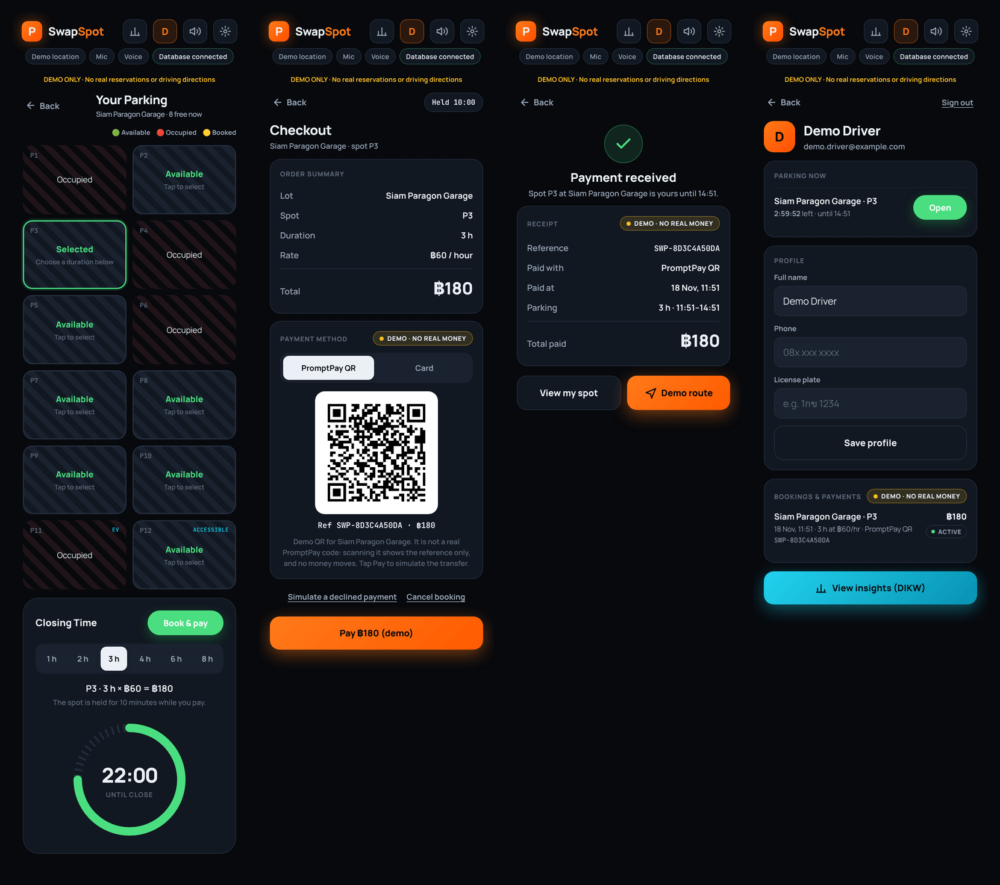
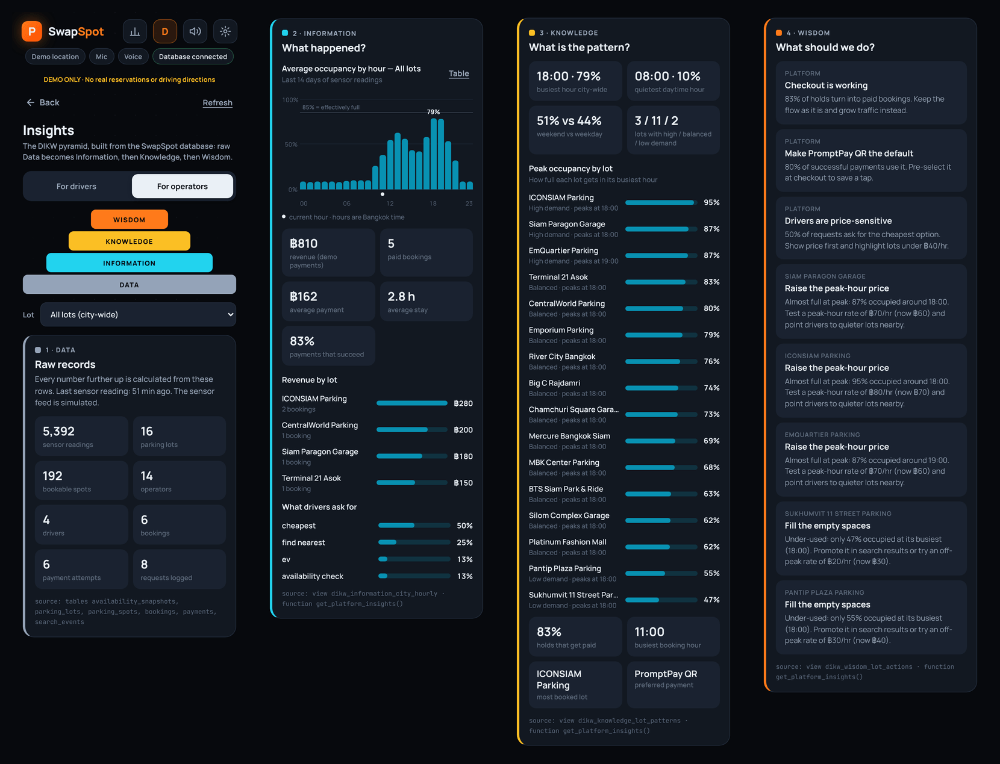

# SwapSpot — Voice Parking Finder Demo

A voice-first parking finder demonstration built with Next.js and a Supabase (Postgres) database. **Location, sensor readings, payments, camera detection, and route previews are simulated. Bookings are saved in the project database, but they do not reserve a real parking space and no money is taken. Do not use the demo for real reservations or driving directions.**

**Live demo:** <https://swapspot-demo.netlify.app> — a public test version on Netlify, built from this code. Anyone can open it and create a test account. It is a demonstration, so do not enter real personal details or a password you use elsewhere.

## Features

- **Voice input & output** — Web Speech API (SpeechRecognition + SpeechSynthesis), optional "Hey SwapSpot" continuous listening, and spacebar push-to-talk. A typed input is also available.
- **Rule-based conversation** — asks for parking, prices, or features, offers a simulated route preview, and opens the account, checkout, and insights screens on request. No AI service is connected.
- **Animated mascot** — reacts to state (bounces while AI speaks, pulses while listening).
- **Barrier-gate loading animation** — plays while searching for spots.
- **Map** — Leaflet + OpenStreetMap tiles (no API key), with a dashed simulated route preview and actions for spot selection, demo camera, and details.
- **Parking data from a database** — 16 lots in central Bangkok and their 192 bookable spots are read from Supabase and refreshed every 20 seconds (spots every 10). The availability numbers come from a simulated sensor feed that runs inside the database.
- **Accounts** — sign up, sign in, and sign out with Supabase Auth (email and password), a profile, and a booking history that only its owner can read.
- **Spot booking** — "Your Parking" grid (P1–P12) with Available / Occupied / Booked states. Choose a spot and a duration; the database holds the spot for 10 minutes, calculates the price (hourly rate × hours, capped at the daily maximum), and refuses double bookings.
- **Demo checkout** — a simulated PromptPay QR or a built-in test card. Every attempt is recorded in a `payments` table with a reference and shown on a receipt. No payment provider is called.
- **Parking session timer** — countdown to the end of the booked time, a reminder 15 minutes before, and an End button.
- **Insights (DIKW)** — raw sensor rows → occupancy by hour → patterns per lot → advice, built as database views and shown for drivers and for operators.
- **Works without the database** — if the database cannot be reached, or has no parking lots yet because the sample data has not been loaded, the app falls back to the built-in simulation (sample lots, generated spots, a timer held in memory) and shows "Offline demo data" in the top bar. Nothing is saved in that mode.
- **Demo camera view** — static image with simulated detection boxes and auto-refresh; it is not a live feed.
- **Filters and preferences** — max price, radius, EV/accessible/covered required, saved to localStorage.
- **Light / dark theme** toggle.

## Screenshots

Taken from the app with the sample data and a few test bookings made with demo accounts.



*Booking: choose a spot and a duration, pay in the demo checkout, get a receipt, and find the booking in the account.*



*Insights for operators: Data, Information, Knowledge, and Wisdom. In the app the four cards follow each other down the page. The view for drivers is in [docs/screenshots/insights-drivers.png](docs/screenshots/insights-drivers.png).*

## Tech stack

- Next.js App Router, React, and TypeScript
- Supabase: Postgres database, Auth, Data API, and `pg_cron` (through `@supabase/supabase-js`)
- Leaflet.js and OpenStreetMap tiles for maps
- Web Speech API for voice
- Google Fonts (Manrope + JetBrains Mono)

## Run locally

Use Node.js 20.19+, 22.13+, or 24+. Install dependencies and start the development server:

```bash
git clone https://github.com/<your-username>/swapspot.git
cd swapspot
npm ci
npm run dev
# open http://localhost:3000
```

The app connects to the project's Supabase database out of the box; its public URL and publishable key are in `lib/supabase-config.ts`. To use another Supabase project, copy `.env.example` to `.env.local` and fill in the two values.

Run `npm test`, `npm run lint`, `npm run typecheck`, and `npm run build` to validate the app. For a local production build, run `npm run build` followed by `npm start`.

Microphone access requires HTTPS or localhost and user permission. Browser speech-recognition support varies; use the typed input when it is unavailable. Depending on the browser, speech recognition may use a remote service. Continuous listening starts when enabled or when the microphone is activated.

## Database

The schema, the business rules, and the analytics are SQL files in `supabase/migrations`. Run them in file-name order in the Supabase SQL editor (or with `supabase db push`):

| Migration | What it creates |
|---|---|
| `swapspot_schema` | Eight tables (`operators`, `parking_lots`, `parking_spots`, `profiles`, `bookings`, `payments`, `availability_snapshots`, `search_events`), their constraints and indexes, and two views |
| `swapspot_functions` | Triggers, the simulated sensor feed, and the booking and payment functions |
| `swapspot_security` | Row level security policies and grants |
| `swapspot_dikw` | The `dikw_*` views and the two insight functions |
| `swapspot_seed` | Sample data: 14 operators, 16 lots, 192 spots, and 14 days of sensor history |
| `swapspot_cron` | Scheduled jobs: the sensor feed and the release of finished bookings |
| `swapspot_wording` | Driver tips say "spot", the word the app uses |

How the database is used:

- The browser reads tables and views, and row level security decides which rows it gets. A driver sees only their own profile, bookings, and payments.
- The browser never writes a booking or a payment directly. It calls database functions (`create_booking`, `start_payment`, `confirm_demo_payment`, `cancel_booking`, `end_booking`), so the price and the payment status are decided by the database.
- Double booking is impossible: unique indexes allow one live booking per spot and one per driver.

The full design is in [docs/database.md](docs/database.md): the ER diagram, a data dictionary, the booking and payment states, the security model, and how each DIKW layer is calculated.

With Supabase's default Auth settings a new account has to confirm its email address before it can sign in. For a classroom demo, turn "Confirm email" off in the Supabase dashboard (Authentication section, providers page, Email).

## Deploy to Netlify

The live demo runs on Netlify with continuous deployment: the Netlify project is linked to the GitHub repository, and every push to the deployed branch builds and publishes a new version at the same address. Nothing has to be deleted or set up again to ship a change.

1. In Netlify, choose **Add new project → Import an existing project**, pick the GitHub repository, and choose the branch to deploy.
2. Keep the detected settings. `netlify.toml` sets the build command (`npm run build`), the publish folder (`.next`), and the Node version. Netlify adds its Next.js runtime by itself.
3. No environment variables are required. To point a deployment at another Supabase project, set `NEXT_PUBLIC_SUPABASE_URL` and `NEXT_PUBLIC_SUPABASE_PUBLISHABLE_KEY` in the Netlify project and deploy again.
4. A new Netlify project can start as private (visible to the team only). Use **Make public** in the Netlify project when testers outside the team should open it.
5. For a public test, turn off **Confirm email** in Supabase (Authentication → Sign In / Providers), or connect your own email provider. Supabase's built-in email service is rate-limited and meant for testing.

Accounts, bookings, and payments are stored in Supabase, not in the deployed site, so publishing a new version does not touch them.

## Deploy to Vercel

1. Import the Git repository into Vercel and select the repository root. Vercel detects the Next.js framework and build settings.
2. Deploy a preview and verify the map, typed and voice input, settings, sign-in, a booking with a demo payment, and the insights screen over HTTPS.
3. Configure the production branch and domain after preview validation. No environment variables are required. To point a deployment at another Supabase project, set `NEXT_PUBLIC_SUPABASE_URL` and `NEXT_PUBLIC_SUPABASE_PUBLISHABLE_KEY`, scoped separately to preview and production.
4. In the Supabase dashboard, set the Site URL (Authentication → URL Configuration) to the deployed address so that email confirmation links lead back to the app.

The publishable key is meant to be public: row level security in the database decides what a visitor can read or change. Never commit a secret or `service_role` key, and never put one in a `NEXT_PUBLIC_` variable; this app does not need one. The public OpenStreetMap tile service has a [usage policy](https://operations.osmfoundation.org/policies/tiles/) and no availability guarantee, so select a suitable tile service for production.

## Project structure

```
swapspot/
├── app/                  # Next.js layout and page
├── components/           # client-side React views, hooks, and browser integrations
├── lib/                  # domain logic, the data layer (backend.ts), and generated database types
├── supabase/migrations/  # the database: schema, functions, security, DIKW views, sample data, scheduled jobs
├── docs/database.md      # database design: ER diagram, data dictionary, security, DIKW
├── docs/screenshots/     # pictures used in this README and in the course reports
├── public/assets/        # images and animations
├── styles.css            # app styles
├── tests/                # focused domain tests
├── .env.example          # optional settings for another Supabase project
├── netlify.toml          # build settings for the Netlify deployment
└── index.html            # original standalone demo, retained for reference
```

## Notes

- Sign-in and the database use Supabase (Auth + Postgres). It replaces the Firebase Authentication and Neon PostgreSQL that were planned earlier: one service covers both, and its row level security keeps each driver's data private without a separate server.
- Payments are simulated. A real payment provider, real parking-operator connections, routing, and camera integration are out of scope for the first release.
- No real parking reservation, barrier control, location tracking, navigation, or payment is performed.
- On Supabase's free plan a project is paused after about a week without activity. Restore it from the dashboard before a demo; until then the app runs on its built-in simulation.

## License

MIT — see [LICENSE](LICENSE).
