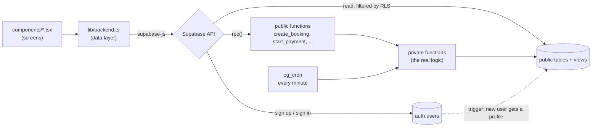
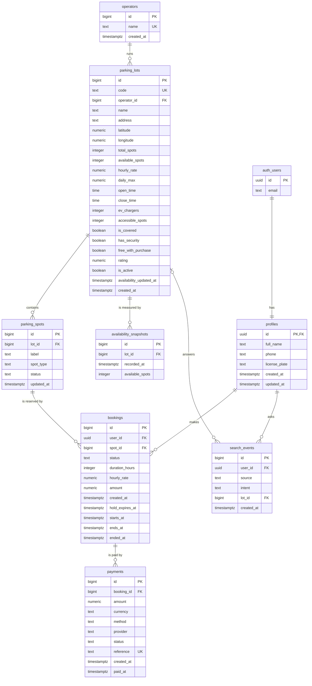
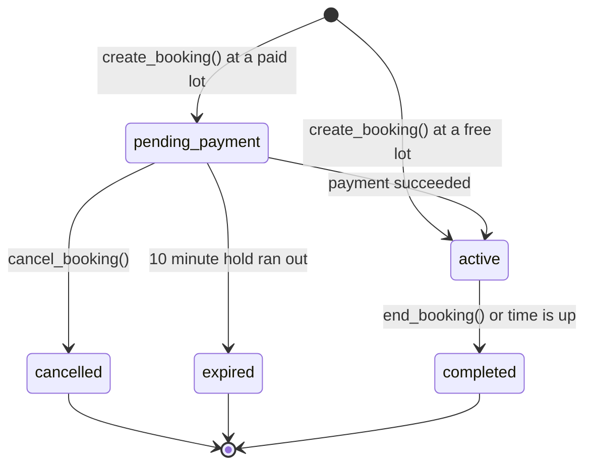
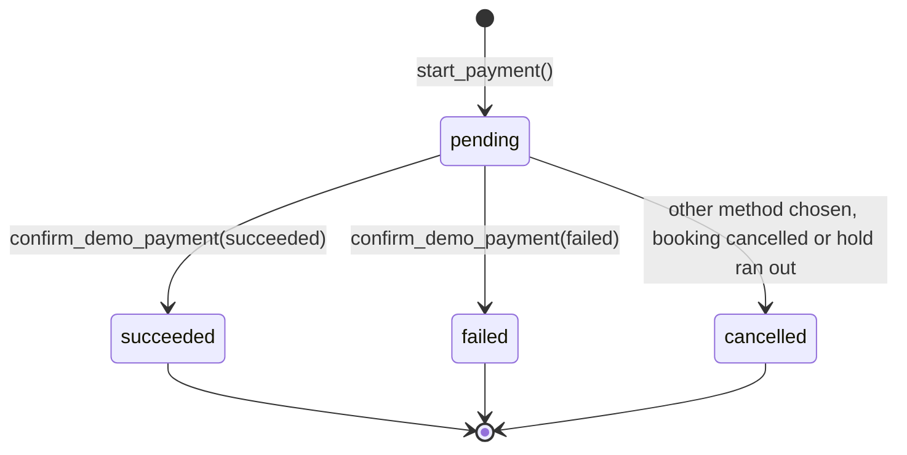

# SwapSpot database

SwapSpot stores its parking lots, spots, accounts, bookings and payments in a
Postgres database hosted on [Supabase](https://supabase.com). This page explains
the design: the tables and how they relate, the rules the database enforces, who
is allowed to see what, and how raw rows are turned into the DIKW pyramid
(Data → Information → Knowledge → Wisdom) shown on the app's **Insights** screen.

The SQL that builds everything is in [`supabase/migrations`](../supabase/migrations).

- [1. How the app talks to the database](#1-how-the-app-talks-to-the-database)
- [2. Entity relationship diagram](#2-entity-relationship-diagram)
- [3. Data dictionary](#3-data-dictionary)
- [4. Rules the database enforces](#4-rules-the-database-enforces)
- [5. Booking and payment flow](#5-booking-and-payment-flow)
- [6. Security](#6-security)
- [7. DIKW: from rows to advice](#7-dikw-from-rows-to-advice)
- [8. Scheduled jobs](#8-scheduled-jobs)
- [9. Queries to try](#9-queries-to-try)
- [10. Setting up your own copy](#10-setting-up-your-own-copy)
- [11. What is simulated](#11-what-is-simulated)
- [สรุปภาษาไทย](#สรุปภาษาไทย)

## 1. How the app talks to the database



Two ideas run through the whole design:

1. **Reads go to tables and views; writes go through functions.** The browser can
   read public parking data and the signed-in driver's own rows. It cannot insert
   or change a booking, a payment or a spot directly. Those changes only happen
   inside database functions, so the price and the payment status are decided by
   the database and never by the browser.
2. **The database is the single source of truth.** The app keeps no copy of prices
   or availability. It asks the database every 20 seconds (spots every 10 seconds).

`lib/backend.ts` is the only file that talks to Supabase. Its two settings (project
URL and publishable key) are in `lib/supabase-config.ts` and can be replaced with
the environment variables listed in `.env.example`. Both are public by design: the
key only identifies the project, and row level security decides what each visitor can do.

The table, view and function names the app uses are checked when it is built:
`lib/database.types.ts` is generated from this schema, so a misspelled column is a
type error, not a surprise at run time. Rows are also read defensively on arrival
(`lib/booking.ts`, `lib/insights.ts`, `lib/lots.ts`), and those readers have unit
tests in `tests/`.

If the database cannot be reached, or has no lots yet, the app falls back to the
built-in simulation of the original demo (sample lots, generated spots, a timer in
memory) and says so on screen. Nothing is saved in that mode.

## 2. Entity relationship diagram



`auth_users` is Supabase's own `auth.users` table (email, password hash). The app
never reads it. Everything else is in the `public` schema.

**Relationships in words**

| Relationship | Cardinality | Meaning |
|---|---|---|
| operators → parking_lots | 1 : N | One company runs many lots. |
| parking_lots → parking_spots | 1 : N | A lot has many bookable spots (12 each in the seed data). |
| parking_lots → availability_snapshots | 1 : N | One reading per lot every 10 minutes. |
| auth.users → profiles | 1 : 1 | Each account has exactly one profile, created by a trigger. |
| profiles → bookings | 1 : N | A driver makes many bookings over time, but only one can be live. |
| parking_spots → bookings | 1 : N | A spot is booked many times, but only one booking can be live. |
| bookings → payments | 1 : N | A booking can have several payment attempts, at most one succeeds. |
| profiles → search_events | 1 : N | Each request to the assistant by a signed-in driver. |
| parking_lots → search_events | 0..1 : N | The lot a request was about, if any. |

## 3. Data dictionary

Types are Postgres types. PK = primary key, FK = foreign key, UK = unique.

### operators

Companies that run parking lots.

| Column | Type | Key | Description |
|---|---|---|---|
| id | bigint | PK | Generated number. |
| name | text | UK | Company name, for example `Siam Piwat`. |
| created_at | timestamptz | | When the row was added. |

### parking_lots

One row per car park on the map.

| Column | Type | Key | Description |
|---|---|---|---|
| id | bigint | PK | Generated number. |
| code | text | UK | Short code used by the app and the voice assistant, for example `sp`. 2–8 lowercase letters or digits. |
| operator_id | bigint | FK → operators.id | Who runs the lot. |
| name | text | | Display name. |
| address | text | | Street address. |
| latitude | numeric(9,6) | | Between -90 and 90. |
| longitude | numeric(9,6) | | Between -180 and 180. |
| total_spots | integer | | Capacity. Must be more than 0. |
| available_spots | integer | | Free spaces right now, from the sensor feed. Between 0 and `total_spots`. |
| hourly_rate | numeric(8,2) | | Price per hour in THB. 0 means free. |
| daily_max | numeric(8,2) | | Highest charge for one booking in THB. Empty means no cap. |
| open_time | time | | Opening time, Bangkok time. |
| close_time | time | | Closing time, Bangkok time. `00:00`–`24:00` means open 24 hours. |
| ev_chargers | integer | | Number of EV charging stalls. |
| accessible_spots | integer | | Number of accessible spaces. |
| is_covered | boolean | | Covered parking. |
| has_security | boolean | | Security on site. |
| free_with_purchase | boolean | | Parking is free for customers of the store. |
| rating | numeric(2,1) | | 0.0 to 5.0. |
| is_active | boolean | | `false` hides the lot from the app. |
| availability_updated_at | timestamptz | | When `available_spots` last changed. |
| created_at | timestamptz | | When the row was added. |

### parking_spots

The spots a driver can book in the app.

| Column | Type | Key | Description |
|---|---|---|---|
| id | bigint | PK | Generated number. |
| lot_id | bigint | FK → parking_lots.id | The lot this spot belongs to. Unique together with `label`. |
| label | text | | Name painted on the spot, for example `P3`. |
| spot_type | text | | `standard`, `ev` or `accessible`. |
| status | text | | `available`, `occupied` (a car is there) or `reserved` (held by a live booking). |
| updated_at | timestamptz | | Set by a trigger on every change. |

### profiles

App data for each signed-in driver.

| Column | Type | Key | Description |
|---|---|---|---|
| id | uuid | PK, FK → auth.users.id | Same id as the account. |
| full_name | text | | Up to 80 characters. |
| phone | text | | 6–20 characters: digits, spaces, `+`, `-`. |
| license_plate | text | | Up to 20 characters. |
| created_at | timestamptz | | When the account was created. |
| updated_at | timestamptz | | Set by a trigger on every change. |

### bookings

A driver reserves one spot for a number of hours.

| Column | Type | Key | Description |
|---|---|---|---|
| id | bigint | PK | Generated number. |
| user_id | uuid | FK → profiles.id | Who booked. |
| spot_id | bigint | FK → parking_spots.id | Which spot. The lot is found through the spot. |
| status | text | | `pending_payment`, `active`, `completed`, `cancelled` or `expired`. |
| duration_hours | integer | | 1 to 24. |
| hourly_rate | numeric(8,2) | | The lot's price **at the time of booking**. |
| amount | numeric(10,2) | | Total to pay: `hourly_rate × duration_hours`, capped at the lot's `daily_max`. |
| created_at | timestamptz | | When the spot was reserved. |
| hold_expires_at | timestamptz | | An unpaid booking gives its spot back at this time (10 minutes after `created_at`). |
| starts_at | timestamptz | | When parking time started (payment time, or booking time for a free lot). |
| ends_at | timestamptz | | When the paid time runs out. |
| ended_at | timestamptz | | When the booking actually finished, was cancelled or expired. |

### payments

Every payment attempt for a booking.

| Column | Type | Key | Description |
|---|---|---|---|
| id | bigint | PK | Generated number. |
| booking_id | bigint | FK → bookings.id | The booking being paid. |
| amount | numeric(10,2) | | Copied from the booking. More than 0. |
| currency | text | | Always `THB`. |
| method | text | | `promptpay_qr` or `card`. |
| provider | text | | Always `demo`: the checkout is simulated. |
| status | text | | `pending`, `succeeded`, `failed` or `cancelled`. |
| reference | text | UK | Shown on the checkout screen and the receipt, for example `SWP-8C026176B3`. |
| created_at | timestamptz | | When the attempt started. |
| paid_at | timestamptz | | Filled in only when `status = succeeded`. |

### availability_snapshots

Sensor history. This is the raw data behind the occupancy analytics.

| Column | Type | Key | Description |
|---|---|---|---|
| id | bigint | PK | Generated number. |
| lot_id | bigint | FK → parking_lots.id | Which lot was measured. |
| recorded_at | timestamptz | | When. |
| available_spots | integer | | Free spaces at that moment. |

### search_events

What signed-in drivers ask the assistant for. Only the kind of request is stored,
never the words that were spoken.

| Column | Type | Key | Description |
|---|---|---|---|
| id | bigint | PK | Generated number. |
| user_id | uuid | FK → profiles.id | Filled in by the database (`auth.uid()`), not by the browser. |
| source | text | | `voice`, `text` or `chip`. |
| intent | text | | `find_nearest`, `cheapest`, `free`, `ev`, `accessible`, `covered`, `navigate`, `reserve`, `price_check`, `availability_check` or `other`. |
| lot_id | bigint | FK → parking_lots.id | The lot the request was about or led to. Can be empty. |
| created_at | timestamptz | | When. |

### Views

| View | What it returns | Used by |
|---|---|---|
| `lot_overview` | Lot + operator name + occupancy % + number of free spots | Map, list, voice assistant |
| `booking_details` | Booking + spot + lot + latest payment | Checkout, account history |
| `dikw_data_summary` | Row counts and the time range of the sensor history | Insights · Data |
| `dikw_information_lot_hourly` | Average occupancy per lot and hour of day | Insights · Information |
| `dikw_information_city_hourly` | Average occupancy for the whole city per hour of day | Insights · Information |
| `dikw_knowledge_lot_patterns` | Peak hour, quiet hour, weekday vs weekend, demand level per lot | Insights · Knowledge |
| `dikw_wisdom_lot_actions` | Recommended action per lot | Insights · Wisdom |

All views are created `with (security_invoker = true)`, so a view never shows a
row its reader could not see in the underlying table.

## 4. Rules the database enforces

These hold even if the app has a bug, because they are constraints, not code in the browser.

| Rule | How |
|---|---|
| A spot can have only one live booking | Partial unique index `bookings_one_live_per_spot` on `spot_id` where status is `pending_payment` or `active` |
| A driver can hold only one spot at a time | Partial unique index `bookings_one_live_per_user` on `user_id` with the same condition |
| A booking is paid at most once | Partial unique index `payments_one_success_per_booking` where `status = 'succeeded'` |
| Two drivers cannot take the same spot at the same moment | `create_booking` locks the spot row (`select ... for update`) before checking it |
| Free spaces never exceed capacity or go below zero | `check (available_spots >= 0)` and `check (available_spots <= total_spots)` |
| Status and type columns only hold known values | `check (status in (...))` on spots, bookings, payments, search events |
| A paid payment always has a payment time, and only a paid one does | `check ((status = 'succeeded') = (paid_at is not null))` |
| An active booking always has a start and an end | `check (status <> 'active' or (starts_at is not null and ends_at is not null))` |
| No orphan rows | Foreign keys on every relationship. Deleting an account removes its profile, bookings, payments and search events |
| Payment references are unique | `unique (reference)` |

**Normalisation.** The tables are in third normal form: every column depends on
its table's key and nothing else. Two columns look like repetition but are kept on purpose:

- `bookings.hourly_rate` copies the lot's price at booking time. If the operator
  changes the price later, old bookings and receipts must keep the price the driver agreed to.
- `parking_lots.available_spots` is the latest reading, while
  `availability_snapshots` keeps the history. The map needs the current number
  on every refresh, the analytics need the history.

Every foreign key column has an index, so joins and cascading deletes stay fast.

## 5. Booking and payment flow





| Step in the app | Function | What the database does in one transaction |
|---|---|---|
| Tap **Book & pay** | `create_booking(p_spot_id, p_hours)` | Checks the driver has no live booking, locks the spot, calculates the amount from the lot's price, inserts the booking, marks the spot `reserved` |
| Checkout opens / method changes | `start_payment(p_booking_id, p_method)` | Cancels any unfinished attempt, inserts a new `pending` payment with a fresh reference |
| Tap **Pay** | `confirm_demo_payment(p_payment_id, 'succeeded')` | Marks the payment `succeeded`, sets `paid_at`, makes the booking `active` and starts the clock |
| Tap **Simulate a declined payment** | `confirm_demo_payment(p_payment_id, 'failed')` | Marks the payment `failed`. The spot stays held so the driver can retry |
| Tap **Cancel booking** | `cancel_booking(p_booking_id)` | Cancels the unpaid booking and its open payment, frees the spot |
| Tap **End** | `end_booking(p_booking_id)` | Completes the booking, frees the spot |
| (nobody) | `private.housekeeping()` every minute | Expires unpaid holds, completes sessions whose time is up, frees those spots |

Tapping **Pay** twice is harmless: the second call sees the payment is already
`succeeded` and returns the same booking.

## 6. Security

Supabase gives the browser two roles. `anon` is a visitor who is not signed in.
`authenticated` is a signed-in driver.

| Object | anon | authenticated |
|---|---|---|
| `operators`, `parking_lots`, `parking_spots`, `availability_snapshots`, `lot_overview`, `dikw_*` views | read | read |
| `profiles` | – | read own row, update own `full_name`, `phone`, `license_plate` |
| `bookings`, `payments`, `booking_details` | – | read own rows |
| `search_events` | – | read own rows, insert own rows (`source`, `intent`, `lot_id` only) |
| `create_booking`, `start_payment`, `confirm_demo_payment`, `cancel_booking`, `end_booking` | – | execute |
| `get_my_insights`, `get_platform_insights` | – | execute |
| Anything in the `private` schema | – | only through the public functions above |

How this is built:

- **Row level security** is enabled on all eight tables. "Own row" policies compare
  the row's owner with `auth.uid()`, the id inside the signed-in driver's token.
- **Grants** are written out table by table (and column by column for `profiles`
  and `search_events`). Nothing relies on Supabase's default grants.
- **The logic that needs more rights than a driver has** (marking a spot reserved,
  marking a payment paid) lives in `security definer` functions in the `private`
  schema, which the API does not expose. Each one checks `auth.uid()` first and
  uses an empty `search_path`. The `public` functions the app calls are thin
  `security invoker` wrappers around them.
- **Passwords** are handled by Supabase Auth. The app never stores them.

One deliberate simplification: `get_platform_insights()` returns totals for the
whole platform (revenue, bookings, requests) to any signed-in user, so the
operator view can be demonstrated without a separate admin account. It returns
aggregates only, never individual rows. A production system would restrict it to
an operator role.

## 7. DIKW: from rows to advice

Each layer is a database object built from the layer below it. The app only displays the result.

| Layer | Question | Database object | Example |
|---|---|---|---|
| **Data** | What was recorded? | Tables `availability_snapshots`, `bookings`, `payments`, `search_events`; view `dikw_data_summary` | `lot 5 · 2026-11-17 18:00 · 140 free` |
| **Information** | What happened? | Views `dikw_information_lot_hourly`, `dikw_information_city_hourly`; totals in `get_platform_insights()` and `get_my_insights()` | "ICONSIAM is 96% full on average between 19:00 and 20:00" |
| **Knowledge** | What is the pattern? | View `dikw_knowledge_lot_patterns`; `knowledge` part of the two functions | "ICONSIAM peaks at 19:00, is busier at weekends, demand level: high" |
| **Wisdom** | What should we do? | View `dikw_wisdom_lot_actions`; `wisdom` part of the two functions | "Test a peak-hour rate of ฿80/hr (now ฿70) and point drivers to quieter lots" |

How each step is calculated:

- **Data → Information.** Group the last 14 days of readings by lot and hour of day
  (Bangkok time) and average the occupancy: `(total_spots - available_spots) / total_spots`.
- **Information → Knowledge.** For each lot, look only at daytime hours while it is
  open. Rank the hours to find the busiest and the quietest, compare weekdays with
  weekends, and label demand: **high** if the peak is 85% or more (a lot that full
  is effectively full for an arriving driver), **low** if the peak is under 60%,
  otherwise **balanced**.
- **Knowledge → Wisdom.** Simple rules. High demand: suggest a peak-hour price
  ฿10 higher. Low demand: suggest promoting the lot or an off-peak price ฿10 lower.
  For a driver: compare their usual lot and booking hour with that lot's pattern,
  and look for a cheaper lot within 1.5 km (distance calculated in SQL).

The Insights screen has two tabs, because the same data answers different questions:

| | For drivers | For operators |
|---|---|---|
| Data | Public sensor rows + my own bookings, payments, requests | All rows (as totals) |
| Information | Occupancy by hour, what I spent, hours booked | Occupancy by hour, revenue, paid bookings, what drivers ask for |
| Knowledge | When my usual lot is busy, when I usually book | Peak occupancy per lot, share of holds that get paid, preferred payment method |
| Wisdom | Where to park right now, when to go, a cheaper lot nearby | Which lots to reprice or promote, what to fix at checkout |

## 8. Scheduled jobs

Set up with `pg_cron` in the `swapspot_cron` migration.

| Job | Schedule | What it does |
|---|---|---|
| `swapspot-tick` | every minute | `private.housekeeping()` releases spots whose booking is over. `private.sensor_tick()` moves the simulated sensors and, every 10 minutes, writes one reading per lot to `availability_snapshots` |
| `swapspot-prune` | daily at 03:15 Bangkok time | Deletes sensor readings older than 60 days and job logs older than 2 days |

The booking functions also call `housekeeping()` themselves, so the rules still
hold if the scheduler is not running.

## 9. Queries to try

Run these in the Supabase SQL editor.

```sql
-- Which lots are fullest right now?
select name, available_spots, total_spots, occupancy_pct, hourly_rate
from lot_overview
order by occupancy_pct desc;

-- Revenue per lot (three tables joined)
select l.name, count(*) as paid_bookings, sum(p.amount) as revenue
from payments p
join bookings b on b.id = p.booking_id
join parking_spots s on s.id = b.spot_id
join parking_lots l on l.id = s.lot_id
where p.status = 'succeeded'
group by l.name
order by revenue desc;

-- Information: the hourly profile of one lot
select hour_of_day, avg_occupancy_pct, readings
from dikw_information_lot_hourly
where lot_code = 'ic'
order by hour_of_day;

-- Knowledge: every lot's pattern
select lot_name, peak_hour, peak_occupancy_pct, quiet_hour, demand_level
from dikw_knowledge_lot_patterns
order by peak_occupancy_pct desc;

-- Wisdom: what to do about it
select lot_name, operator_action, suggested_rate, operator_tip
from dikw_wisdom_lot_actions
where operator_action <> 'keep_price';

-- The double-booking rule: the second insert is refused by the database
-- (replace the ids with real ones from your tables)
insert into bookings (user_id, spot_id, status, duration_hours, hourly_rate, amount)
values ('<user id>', 1, 'pending_payment', 1, 60, 60);
insert into bookings (user_id, spot_id, status, duration_hours, hourly_rate, amount)
values ('<another user id>', 1, 'pending_payment', 1, 60, 60);
-- ERROR: duplicate key value violates unique constraint "bookings_one_live_per_spot"
```

## 10. Setting up your own copy

1. Create a project at [supabase.com](https://supabase.com).
2. Open the SQL editor and run the files in `supabase/migrations` in file-name order
   (or use `supabase db push` with the Supabase CLI):

   | Migration | What it creates |
   |---|---|
   | `swapspot_schema` | The eight tables, their constraints and indexes, and the views `lot_overview` and `booking_details` |
   | `swapspot_functions` | Triggers, the simulated sensor feed, and the booking and payment functions |
   | `swapspot_security` | Row level security policies and grants |
   | `swapspot_dikw` | The `dikw_*` views and the two insight functions |
   | `swapspot_seed` | Sample data: 14 operators, 16 lots, 192 spots, 14 days of sensor history |
   | `swapspot_cron` | The scheduled jobs (needs the `pg_cron` extension) |
   | `swapspot_wording` | Driver tips say "spot", the word the app uses |

3. Copy `.env.example` to `.env.local` and fill in the project URL and the publishable key
   (from the project's API settings). On Vercel, add the same two variables to the project.
   Never use the secret or `service_role` key in the app.
4. In the dashboard's Authentication section, open the providers page, choose Email, and decide about **Confirm email**:
   - Off: a new account is signed in straight away. Easiest for a demo.
   - On (Supabase's default): a new driver must click a link in an email first.
     Also set the Site URL (Authentication → URL Configuration) to the address
     where the app is hosted, so the link leads back to the app. Supabase's built-in
     email service is rate-limited and meant for testing, so add your own SMTP
     provider before inviting many people.

On the free plan Supabase can pause a project that has had no activity for about
a week. If that happened, restore it from the dashboard before a demo. While the
database cannot be reached, the app runs its built-in simulation instead and nothing is saved.

## 11. What is simulated

| Part | Real or simulated |
|---|---|
| Lots, spots, accounts, bookings, payments, search events | Real rows in the database |
| Prices, totals, holds, double-booking protection | Real, calculated and enforced by the database |
| Availability numbers and spot occupancy | Simulated sensor feed (`private.sensor_tick`), a daily pattern with two peaks |
| The 14 days of history in the seed data | Generated from the same pattern |
| Payments | Simulated. `provider = 'demo'`. No gateway is called and no money moves |
| Location, navigation and the camera view | Simulated in the browser |

## สรุปภาษาไทย

- ฐานข้อมูลมี 8 ตาราง: `operators` → `parking_lots` → `parking_spots` → `bookings` → `payments` และ `profiles` (ผู้ใช้), `availability_snapshots` (ข้อมูล sensor ย้อนหลัง), `search_events` (สิ่งที่ผู้ใช้ถามผู้ช่วย)
- ราคา ยอดเงิน และสถานะการจ่ายเงิน คำนวณในฐานข้อมูลทั้งหมด เบราว์เซอร์แก้เองไม่ได้
- ฐานข้อมูลกันการจองซ้อนเอง: ช่องจอด 1 ช่องมีการจองที่ยังไม่จบได้ครั้งเดียว และผู้ใช้ 1 คนจองได้ทีละช่อง
- RLS ทำให้ผู้ใช้เห็นเฉพาะโปรไฟล์ การจอง และการจ่ายเงินของตัวเอง ส่วนข้อมูลที่จอดทุกคนอ่านได้
- DIKW ทำเป็น view ในฐานข้อมูล: Data (แถวดิบ) → Information (ค่าเฉลี่ยรายชั่วโมง) → Knowledge (ชั่วโมงพีค ระดับความต้องการ) → Wisdom (คำแนะนำ) แล้วแอปแสดงผลในหน้า Insights
- การจ่ายเงินและตัวเลขที่ว่างเป็นการจำลอง ไม่มีเงินจริง
